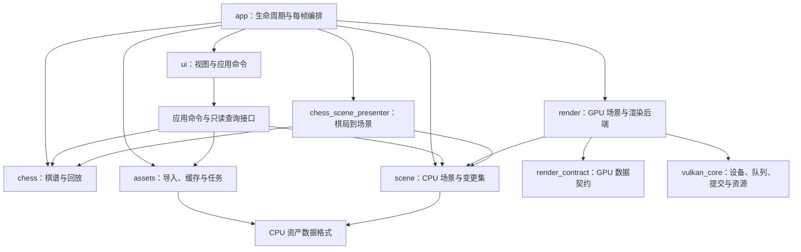

# 项目调整实施方案与交接规范

> 编写日期：2026-10-17。适用项目：本仓库 `chinese-chess`。
> 本文件是可以脱离聊天记录使用的实施说明。创建本文件不代表已经实施其中的代码调整。
> 当前状态：2026-10-18，T01、T02 均为 DONE。T02 已完成统一帧调度与呈现 fence、副窗口适配，普通 Debug/Release 构建、两配置各 200 次窗口压力、各 3 次截图跨尺寸关闭、T01 回归与 T02 ASan 均通过，严格验证不再排除 WSI 错误，详见 T02_IMPLEMENTATION.md。用户明确要求 T00 放最后执行；当前后续任务为 T03。历史失败和修复证据均保留。
> 最新用户指令（2026-10-18，优先于下文旧要求）：清除所有项目测试，待功能和架构进一步完善后再考虑。测试源码、脚本、专用宏/入口、错误注入、测试构建目录和已确认的测试截图已移除；T01/T02 实际修复保留。T00 及 T05/T15 等任务中的测试框架、CTest、测试预设和自动化部分全部暂缓，恢复须用户另行明确要求。下文测试矩阵、命令、历史日志路径仅为远期草案或历史记录，不能当作当前入口，也不能据此重新添加测试。当前只做普通构建检查；删除测试本身不算新增修复证据。

## 1. 执行约定

### 1.1 目标与范围

按照“正确性 → 可测试的模块边界 → 资产与渲染质量 → 性能与交付”的顺序，调整现有 Windows C++/Vulkan 项目。允许破坏性修改内部接口、缓存格式、GPU 数据布局、目录结构和构建配置，不要求旧接口或旧缓存兼容。

保留以下产品能力：三种渲染模式（光栅化、光追管线、Ray Query）、象棋棋盘与棋谱回放、场景/相机/材质/灯光编辑、模型与纹理导入、热重载、截图、ImGui docking 与多窗口。对合法的现有资源和棋谱建立行为基线；对于原先静默接受的非法输入，可以改为明确拒绝。

本轮不扩展为完整象棋规则引擎、棋力 AI、网络对战、跨平台引擎、通用 RHI、微服务或完整 ECS。优先完成一个可维护的模块化桌面程序。功能范围扩张不是完成本方案的必要条件。

### 1.2 接手者必须先做的事

1. 从仓库根目录读取本文件、适用的 `AGENTS.md`、[CLAUDE.md](CLAUDE.md)、[CMakeLists.txt](CMakeLists.txt) 和 [CMakePresets.json](CMakePresets.json)。本文使用文件名和符号定位；源码发生移动时先搜索符号。
2. 执行 `git status --short`，确认当前源码是否与第 2 节基线一致。保留用户已有改动；不能用 `git reset`、`checkout --`、批量删除或旧版本覆盖来获取“干净”基线。
3. 只在收到实施授权后执行代码任务。本次文档交付自身只新增本文件。后续“执行此方案”“开始 T01”等指令即为相应实施授权；不应再为普通重构反复询问。
4. 从第 12 节选择依赖已满足、状态为 `TODO` 的任务。若代码已解决某问题，应先复核并补证据，不能照文档重复重写。
5. 实际源码、测试和运行结果优先于历史描述。遇到偏差，在本文件的执行记录中说明事实、影响和替代做法；不要无声改变目标或降低验收标准。

### 1.3 实施纪律

- 一项任务形成一个可构建、可验证的闭环。不要先大规模搬文件，再将失去可构建性的工程交给下一会话。
- 可以直接替换内部接口，不建立长期兼容层；临时桥接必须注明移除任务，最终清理。
- 保持 C++23、显式包含依赖、现有命名风格、MSVC `/W4 /WX`。同目录头文件使用文件名，跨目录使用目录前缀。
- 当前部分仅包含头文件的 `.cpp` 用于头文件独立编译检查。删除前必须由构建测试替代该能力。
- 不顺带提交、推送或发布。是否创建 Git 提交服从后续用户指令；交接不以必须提交为前提。
- 不以增加 `waitIdle`、屏蔽验证错误、降低告警等级或禁用测试作为修复完成的证据。
- 代码检查、编译成功、GPU 运行验证是三种不同证据。未运行的检查标记 `未验证`，不得写为通过。

## 2. 已扫描的项目基线

### 2.1 项目定位与技术构成

本项目目前是“象棋棋谱展示 + 场景编辑 + 多路径渲染”的桌面程序，并非完整的象棋对弈系统。扫描统计为 49 个 `.cpp`、48 个 `.h`、9 个 `.slang`，合计约 13,847 行，包含空行与注释。此数字用于识别基线，不作为未来代码规模目标。

主要依赖：C++23/MSVC、Vulkan 1.4、Slang、GLFW、ImGui、VMA、GLM、OpenColorIO、OpenImageIO、KTX、fastgltf、FreeType、ICU、OpenSSL、msft proxy。依赖版本以 `vcpkg.json`、`vcpkg-configuration.json`、overlay 和实际锁定基线为准。

目前默认使用光追模式；棋盘、棋盘线及 32 个棋子由 UI 相关代码组织创建。资源和着色器路径依赖进程当前工作目录。`MAX_FRAMES_IN_FLIGHT` 为 3，`MAX_BINDLESS_TEXTURES` 为 1024。

### 2.2 源码入口与职责

| 当前入口 | 当前职责与主要问题 |
|---|---|
| [window/main.cpp](chinese-chess/window/main.cpp)、[window/window.cpp](chinese-chess/window/window.cpp) | 启动、事件分发、主循环；回调包含可能抛异常或耗时的工作 |
| [vulkan_application.cpp](chinese-chess/vulkan_core/vulkan_application.cpp)、[vulkan_swapchain.cpp](chinese-chess/vulkan_core/vulkan_swapchain.cpp) | 主帧与呈现；帧推进分散，异常路径缺乏统一状态 |
| [vulkan_commandbuffer.cpp](chinese-chess/vulkan_core/vulkan_commandbuffer.cpp)、[vulkan_semaphore.cpp](chinese-chess/vulkan_core/vulkan_semaphore.cpp)、[vulkan_recycle_bin.h](chinese-chess/vulkan_core/vulkan_recycle_bin.h) | 提交、完成等待、延迟回收；完成凭据与资源最后使用关系不明确 |
| [scene_manager.h](chinese-chess/scene/scene_manager.h) | 同时管理 CPU 对象、GPU 资源、渲染器、热重载、截图和帧计数 |
| [scene_model_manager.cpp](chinese-chess/scene/scene_model_manager.cpp)、[scene_material_manager.cpp](chinese-chess/scene/scene_material_manager.cpp)、[scene_texture_manager.cpp](chinese-chess/scene/scene_texture_manager.cpp) | 对象管理与 GPU 投影混合；全局 dirty 放大更新范围 |
| [scene_handle_map.h](chinese-chess/scene/scene_handle_map.h)、[scene_handle.h](chinese-chess/scene/scene_handle.h) | 已有代际句柄，可作为 CPU 场景身份体系的基础 |
| [scene_rasterization_render.cpp](chinese-chess/scene/scene_rasterization_render.cpp)、[scene_raytracing_render.cpp](chinese-chess/scene/scene_raytracing_render.cpp)、[scene_rayquery_render.cpp](chinese-chess/scene/scene_rayquery_render.cpp) | 三种 GPU 渲染后端；存在重复的绑定和更新逻辑 |
| [ui_manager.cpp](chinese-chess/ui/ui_manager.cpp)、[ui_record.cpp](chinese-chess/ui/ui_record.cpp)、[ui_node.cpp](chinese-chess/ui/ui_node.cpp) | 界面、快捷键、棋谱状态、棋子表示和场景直接修改耦合 |
| [file_watcher.cpp](chinese-chess/tools/file_watcher.cpp)、[shader_compiler.cpp](chinese-chess/tools/shader_compiler.cpp) | 文件摘要与编译缓存；全局生命周期和缓存一致性需要调整 |
| [model_loader.cpp](chinese-chess/tools/model_loader.cpp)、[record_loader.cpp](chinese-chess/tools/record_loader.cpp) | glTF 与棋谱导入；结构化结果及错误表达不足 |
| [path_tracing.slang](chinese-chess/shaders/path_tracing.slang)、[shader_utils.slang](chinese-chess/shaders/shader_utils.slang)、[pbr.slang](chinese-chess/shaders/pbr.slang) | 传输、累计与材质计算；法线、累计精度和纹理语义需要统一 |

### 2.3 已有验证与限制

| 证据 | 结果 | 不能据此得出的结论 |
|---|---|---|
| 使用现有 `out/chinese-chess.vcxproj` 构建 Release/x64 | 成功，49 个 C++ 翻译单元完成编译，生成 `out/Release/chinese-chess.exe` | 不代表新建 CMake 构建目录成功，也不代表 GPU 同步正确 |
| 12 个现有 Slang 入口逐一编译 SPIR-V | 成功，命令见第 9 节 | 不包含全部运行时 OCIO 注入组合，也不证明 CPU/GPU 布局一致 |
| 隔离目录中的文件摘要最小复现 | 第一次变更检查为 1，第二次为 0，已有 sidecar 会被复用 | 未执行真实纹理热重载 GPU 验证 |
| Vulkan 完成信号、回收、WSI、法线等问题 | 源码路径与规范比对 | 未取得本机 GPU 验证层运行日志、性能基线或驱动兼容结论 |

旧验证产物位于被忽略的 `out/review-20261017/`。该目录可能不存在于其他机器，不能成为实施或 CI 的前置依赖。将所需复现重建为仓库内正式测试。

### 2.4 编写时已经存在的用户改动

以下列表仅用于提醒接手者保护工作区，不意味着这些文件不能继续修改：

```text
M CLAUDE.md
M chinese-chess/scene/scene_camera.cpp
M chinese-chess/tools/model_loader.cpp
M chinese-chess/tools/model_loader.h
M chinese-chess/tools/shader_compiler.cpp
M chinese-chess/tools/shader_compiler.h
M chinese-chess/ui/ui_manager.cpp
M chinese-chess/ui/ui_manager.h
M chinese-chess/ui/ui_record.cpp
M chinese-chess/window/window.cpp
?? chinese-chess/resources/models/Box.glb
?? chinese-chess/resources/models/Cube.glb
?? chinese-chess/resources/models/Sphere.glb
```

## 3. 问题清单与优先级

P1 表示应先处理的正确性或生命周期问题；P2 表示架构、数据质量和显著效率问题；P3 表示在正确性建立后的进一步优化。优先级不表示已经观察到用户机器上的崩溃。

| ID | 优先级 | 事实或风险 | 对应任务 |
|---|---|---|---|
| F01 | P1 | `vulkan_commandbuffer::submit` 使用 `eNone` 信号阶段，却把 timeline 值作为整次提交完成凭据 | T01 |
| F02 | P1 | `retire` 隐式读取当前 CPU 值；BLAS scratch、TLAS instance 临时缓冲在构建提交前被登记回收 | T01 |
| F03 | P1 | 图形和传输队列共享 timeline；跨队列数值分配不等于 GPU 信号顺序 | T01 |
| F04 | P1 | 呈现信号量按轮换 frame 索引复用；acquire 失败时应用与 scene/UI 帧推进不一致 | T02 |
| F05 | P1 | `reload_all_textures` 先更新摘要，上传路径再次检查得到“未变”，可能复用旧 `.ktx2` | T03 |
| F06 | P2 | `file_watcher` 缓存读取缺乏完整长度/数量/读取结果边界；全局初始化及析构 I/O 难恢复 | T03、T10 |
| F07 | P2 | 应用快捷键在 ImGui 键盘捕获判断之前执行；部分 `noexcept` 路径执行可抛操作 | T04 |
| F08 | P2 | 非等比缩放已被 UI 支持，但 shader 法线使用直接模型矩阵变换 | T04 |
| F09 | P2 | 可变裸指针/引用和手动 `need_*_update` 允许绕过引用维护与失效标记 | T06、T07 |
| F10 | P2 | UI 承担棋谱状态和棋子实体创建；加载失败、初始局面与回放索引契约不清晰 | T08 |
| F11 | P2 | glTF 导入合并 primitive，节点层级、实例、材质和拓扑处理不足 | T09 |
| F12 | P2 | 达到 2048 累计上限后仍发起采样工作；累计与半精度输出、曝光耦合 | T11 |
| F13 | P2 | CPU 纹理通道定义与 GPU 实际材质能力不一致；sRGB/线性、mip 与环境采样语义不完整 | T12、T13 |
| F14 | P2 | 对象变化扩大为 TLAS/SSBO/描述符整体更新；网格变化扩大为全量打包和 BLAS 重建 | T07、T14 |
| F15 | P2 | 截图线程替换会 join 阻塞；秒级文件名冲突；resize 中重新生成并压缩棋子字形 | T10 |
| F16 | P2 | 单一 CMake target、无正式测试与 CI；文档与预设有陈旧信息，运行依赖 cwd | T05、T15 |
| F17 | P3 | 默认选择最高支持 MSAA；RT/RQ 传输主循环重复，缺少可比较的质量/性能证据 | T13、T14 |

## 4. 目标架构与设计决策

### 4.1 模块边界

下面是目标模块依赖，箭头表示“使用”。路径是建议的新路径，尚不存在；实施时可以调整命名，但不得改变依赖方向。



| 目标目录/构建目标 | 负责 | 禁止依赖 |
|---|---|---|
| `chess/` / `chess_domain` | 棋谱解析结果、棋局快照、游标、棋子稳定身份 | Vulkan、GLFW、ImGui、GPU 上传 |
| `scene/` / `scene_domain` | CPU 场景对象、句柄、引用关系、变更 revision | Vulkan 类型、渲染器、UI |
| `assets/` / `asset_pipeline` | CPU 导入、摘要、缓存、作业结果；GPU 发布由 render/app 完成 | ImGui、直接操纵场景 GPU 对象 |
| `render_contract/` | CPU/GPU 布局、绑定编号和布局验证 | UI、资源管理实现；CPU domain 不包含此目录 |
| `vulkan_core/` / `vulkan_backend` | Vulkan 资源、提交 token、frame scheduler、WSI、回收 | 棋谱、编辑器、具体 PBR/棋子业务 |
| `render/` / `scene_renderer` | `scene_gpu`、绑定映射、三后端、累计/显示变换 | ImGui、棋谱解析 |
| `ui/` / `editor_ui` | 显示只读状态、发出应用命令、短期控件状态 | Vulkan 提交、CPU 场景内部容器、资产压缩 |
| `app/` 与 `window/` | 服务组装、窗口事件、错误展示、每帧阶段、棋局到场景适配 | 不应成为业务算法与 Vulkan 实现的聚集处 |

依赖通过 target 链接和公共 include 边界约束。`scene_domain` 与 `chess_domain` 必须能在不创建窗口、不初始化 Vulkan 的进程中运行测试。保留现有代际句柄思路，不因拆模块而重新引入 `shared_ptr` 所有权网络。

### 4.2 决策记录（初始均为 Proposed）

实施对应任务时补充状态和验证结果；不要把此表当作已经完成的 ADR。

| 决策 | 选择与原因 | 代价、替代方案与验证 |
|---|---|---|
| ADR-01 提交与完成 | 每个实际 `VkQueue` 一个完成 timeline；显式 token 和依赖集 | 需要重写调用点；继续全局 timeline 需全序化多队列，复杂且抑制并行。T01 验证独立队列与别名队列 |
| ADR-02 CPU/GPU 分离 | CPU store 作为场景真源，GPU 投影消费带 revision 的变更 | 增加映射层，但消除 UI 手动 dirty。T06/T07 验证无设备测试与更新计数 |
| ADR-03 场景修改入口 | 只读查询 + 语义明确的 mutation；变更自动分类 | 更多显式接口；不采用任意可变引用或先建设通用命令总线。T06 验证引用与失效 |
| ADR-04 资产流水线 | CPU 任务后台执行，主线程验证版本并发布 GPU 结果 | 需要取消/过期任务处理；先保留有界线程队列，不引入大型作业系统。T03/T10 验证失败事务 |
| ADR-05 累计与输出 | 线性 RGBA32F 累计 + 独立显示图像与曝光/OCIO pass | 增加一张图像及带宽；换取精度和显示参数独立变化。T11 测量显存与 GPU 时间 |
| ADR-06 渲染编排 | 明确的 upload/build/render/display/UI/present 阶段 | 暂不引入通用 render graph；资源状态仍须显式追踪。T02/T07 验证依赖完整性 |
| ADR-07 呈现回收 | 按 swapchain image 管理呈现等待信号量；优先采用 KHR swapchain maintenance present fence | 需要查询并启用真实设备特性。无兼容要求，默认缺失所需特性则启动报明确原因；若改变要求，记录替代回收证明，不添加未经验证的隐式降级 |

### 4.3 关键接口契约

以下为设计约束与接口草图，不是已经存在、可以直接调用的 API。接手者负责实现并测试。

**提交与资源生存期**

```cpp
// 概念草图：具体命名沿用项目规范。
struct submission_token { queue_id queue; uint64_t value; };
struct completion_set { /* 按实际 queue 合并的若干 token */ };
submission_token submit(queue_id, recorded_commands, dependency_list);
void retire(owned_resource, completion_set last_use);
```

- `queue_id` 标识实际队列，不仅是 queue family 或“graphics/transfer”用途名称。两个用途拿到相同 `VkQueue` 时必须共享提交序列和外部同步锁。
- 完成 token 只在成功提交后发布，使用覆盖整次命令执行的 `ALL_COMMANDS` 信号阶段。提交失败不能产生可等待的假 token；device lost 进入统一停止路径。
- 每个队列的 value 分配与实际提交顺序一起串行化。若使用原子递增，取 `fetch_add` 返回值计算自己的值，不能递增后再次读取共享计数器。
- 跨队列必须显式等待生产者 token，并正确处理访问屏障与 queue family ownership；timeline 值大小不能代替这两件事。
- 同一 timeline 的多个等待合并为最大 value，并合并需要的 stage mask；不能把一个值的更晚等待阶段错误当作另一个值的完整消费者范围。
- scratch/上传暂存区按消费者提交完成回收；被替换的旧资源按所有最后读取者回收。新资源上传完成不证明旧资源已经没有读者。
- command pool、descriptor、AS、image view、bindless slot、readback 与引用的内存都遵守同一规则。回收项可以等待多个队列，不依赖单个全局计数值。
- 录制中的资源由 submission builder 持有；成功提交后登记最后使用。失败时区分“尚未提交可立即释放”和“先前提交仍在使用”，不得漏记、重复释放或把未提交值交给回收器。
- 不同队列 token 无总序；回收容器不能只因队首未完成就无限阻挡其他已经完成的条目。服务、device 和 timeline 的生命期长于所有在途作业及回收项。

**每帧编排与 WSI**

- 使用一个 `frame_context`，包含 frame slot、acquired image index、本帧依赖与完成凭据。app、scene、UI 不再各自维护含义不一致的 current frame。
- `begin_frame` 先等待该 slot 上一轮真实提交，再尝试 acquire；返回 `ready`、`skip`、`recreate` 或明确错误。仅 `ready` 进入依赖 swapchain 的录制/提交。
- acquire 的 binary semaphore 归 frame slot，复用前确保其上次等待已完成；供 present 等待的 binary semaphore 归 swapchain image，复用必须有上一轮 present 已消费它的证明。
- acquire 成功后中途失败也必须处理已信号的 semaphore 及已获取图像：走明确的空提交/呈现清理或销毁重建流程。不能简单返回后在下一帧复用。
- minimize/零尺寸跳过渲染；out-of-date 请求重建；suboptimal 允许完成当前已获取帧后重建。resize 回调只记录请求，主循环在安全边界处理。
- GPU 渲染完成与 presentation engine 安全释放资源是不同条件。旧 swapchain/呈现信号量回收使用维护扩展的 present fence 等可证明条件，不把普通 frame timeline 或 `deviceWaitIdle` 当作所有呈现生命周期的替代证明。
- ImGui 平台窗口也必须明确所有者与关闭/resize/提交等待关系。可以继续由官方后端管理独立 swapchain，但必须验证其与本项目 device/queue 的同步及销毁顺序。

**场景变更、绑定与资源状态**

- 查询返回值或受限只读视图，跨 mutation/容器结构变化时仅保存 handle。不能长期保存 vector 元素指针。
- mutations 至少区分 camera、transform、material scalar、material texture binding、light、topology/mesh、environment、render settings。
- 变更带 revision，GPU 投影成功后再确认已消费；上传失败不能清掉尚未处理的 CPU 变更。多个消费者各有消费位置或确认策略。
- GPU 绑定槽位与 CPU handle 解耦，槽位带 generation/可验证映射；slot 释放也等待旧 GPU 使用完成。资源地址/布局/描述符变化与数值内容变化分开记录。
- 资源状态与 ownership 追踪必须覆盖提交依赖。对录制中推测的 layout，不得在提交失败后当作真实状态继续使用。

**资产与缓存事务**

- 摘要查询不改变“已成功导入版本”。资产 key 至少包含规范化路径、源内容、导入器版本、纹理用途/色彩空间、mip/压缩参数及依赖内容。
- shader key 保留已有编译器版本与编译参数维度，并把依赖规范化路径和摘要配对；运行时注入内容、OCIO 配置影响产物时也必须进入 key。
- CPU cooked 产物完成并通过校验后，可原子发布磁盘缓存；活动资产的 committed revision 仅在上传与发布成功后前进。这两个提交点不同。
- 导入、上传或发布失败保留旧可用资产与旧 committed revision，并支持重试。后台结果携带请求 revision，过期结果不覆盖新编辑。
- 缓存是不可信输入：magic/version、总字节上限、条目/字符串长度、整数溢出、完整读取、源文件 I/O 错误都需检查。坏缓存降级为重建并可诊断；析构不承担必须成功的持久化。

**CPU/GPU 布局与色彩**

- 对 GPU 使用的布局建立唯一契约，明确 align、sizeof、offset、矩阵布局与 binding。涉及 mat3、padding、数组 stride 的改动必须有反射或读回验证，不能只看 C++ `static_assert`。
- domain 类型不直接充当 GPU packed struct；投影阶段完成转换。normal matrix 在 CPU 每对象计算，并拒绝非有限/不可逆变换。
- 光照和累计在明确的线性色彩空间；显示曝光/OCIO 在单独 pass。albedo/emissive 按颜色纹理解码，normal/metallic/roughness/occlusion 按数据纹理解码。

## 5. 可执行任务

任务内的文件名指当前入口；拆分后在执行记录中登记替代路径。所有任务都要更新第 12 节，不得仅提交实现而不记录验证状态。

### T00：建立可重复的基线和最小验证入口

**依赖：** 无。**目标：** 后续修改有可比较的事实依据。

1. 核对工作区、工具链和实际依赖目录，记录编译器、CMake、Slang、Vulkan loader、GPU/驱动信息。GPU 信息未取得就标记未取得。
2. 按第 9 节执行现有构建与 12 个 shader 编译。记录命令、退出码、产物路径；旧 `.vcxproj` 路径只用于建立历史基线。
3. 在 `tests/` 增加最小 CPU 测试注册与执行入口，开启 CTest。可使用少量无第三方框架的测试可执行文件；失败必须显式返回非零，不能依赖 Release 下被移除的 `assert`。
4. 将 F05 摘要双重检查复现转为正式测试；在修复前确认它能够暴露原始错误。记录当前三模式截图、默认棋局/棋谱行为与输入路径；没有 GPU 就登记待补。
5. 准备诊断计数：提交次数、上传字节、BLAS build/update、TLAS build/update、descriptor 重建、采样 dispatch、待回收资源数量/字节。可以分任务逐步接入，不要求先写通用监控系统。

**交付：** `tests/` 初始目录、基线记录、能够失败的回归入口。测试素材使用小型可生成资源或仓库已有授权资源，不依赖未跟踪的 Box/Cube/Sphere 文件。

**验收：** BASE-01、CACHE-01 的修复前复现记录；测试失败确实使 CTest 返回非零。不能把预期失败测试当作最终常驻绿色测试。

### T01：重建提交完成凭据与延迟回收

**依赖：** T00。**当前入口：** `vulkan_commandbuffer::{submit,wait,get_submit_info}`、`vulkan_semaphore::next`、`vulkan_queue`、`vulkan_recycle_bin::{retire,release}`、`vulkan_common::{upload_buffer,upload_image}`、`scene_model_manager::{update_meshes,update_tlas}`。

1. 枚举所有 submit、wait、retire 与 command buffer reset 调用点，画出 upload → ownership → AS build → render → capture 的真实依赖；确认各队列是否实际为同一个 `VkQueue`。
2. 实现第 4.3 节的 per-queue token、dependency set 与队列提交串行化。整次提交完成信号用 `ALL_COMMANDS`；不要仅改一个 stage mask 就结束此任务。
3. 将 `retire(resource)` 改为必须提供 `last_use`。删除隐式读取全局 CPU 计数器的接口，逐个更新暂存资源、旧 buffer/image/AS、descriptor 和 slot 回收。
4. BLAS scratch、TLAS instance buffer 在构建提交成功并得到 token 后登记回收；旧网格缓冲同时考虑 BLAS build 与后续 shader 读取，旧 AS 同时考虑遍历读者。
5. 以真实资源用途选择 consumer wait stage/access，检查 transfer 与 graphics 分属不同 family 时的 release/acquire 配对；相同 family 不做无意义 ownership 转移。
6. 使 command buffer/pool reset 等待自身最近一次提交完成。为未提交对象、空依赖、重复依赖、别名队列和 submit 失败规定行为。

**交付：** 新提交/回收 API、全部调用点迁移、调试 token/资源最后使用诊断、回归测试。

**验收：** SYNC-01—SYNC-04。回收器只能释放所有最后使用凭据已完成的对象；正常帧不能新增全设备空闲等待。出现 device lost 走有日志的终止/恢复策略，不无限等待永远不会完成的 token。

### T02：统一帧调度、交换链与窗口异常路径

**依赖：** T01。**当前入口：** `vulkan_application::render`、`vulkan_swapchain::{acquire_image,present,get_signal_info}`（名称以源码为准）、scene/UI 的 `current_frame`、`window` resize 回调。

1. 引入 `frame_context`/`frame_scheduler`，统一 frame slot 的等待与推进。尽早 acquire，成功后再安排依赖该帧的 scene/UI/final composition。
2. 将 present 等待信号量与 `current_index` 即 acquired image index 绑定，和 frame slot 的 acquire semaphore 分开管理。
3. 用显式结果表达 ready、skip、recreate、fatal；处理 out-of-date、suboptimal、最小化、零尺寸及 acquire 成功后异常。帧未提交时不伪造完成值。
4. resize 事件只更新请求尺寸；同一轮合并多个事件。主循环等待必要资源后重建 swapchain/尺寸相关资源。
5. 查询并启用 `VK_KHR_swapchain_maintenance1` 及对应 feature，使用 `VkSwapchainPresentFenceInfoKHR` 等机制证明旧呈现资源可回收。头文件存在不等于设备支持；按 ADR-07 给出明确启动诊断。
6. 多窗口拖出、关闭与主窗口重建时验证 ImGui 后端的队列外部同步和资源销毁边界。捕获任务不得引用已销毁的旧尺寸图像。

**交付：** 唯一帧状态机、可控 acquire/present 错误注入点、呈现生命周期日志。

**验收：** WSI-01—WSI-03、SYNC-04；连续 200 次 resize/minimize/restore 和多窗口关闭没有死锁、信号量重复使用、未完成 command buffer reset、已销毁图像访问。测试次数是覆盖要求，不是稳定性保证的上限。

### T03：修复热重载并建立事务性缓存

**依赖：** T00。**当前入口：** `file_watcher::{is_file_modified,构造,析构}`、`scene_texture_manager::{reload_all_textures,reload_texture,upload_texture_data}`、`shader_compiler` 缓存读写。

1. 将“计算当前摘要”“比较成功版本”“提交新版本”拆开。外层扫描与内层导入复用同一检查结果，内层不能消费第二次变更通知。
2. 引入明确的 import key；同源文件作为颜色贴图和数据贴图时不能共享错误的 sidecar。将缓存放入显式 cache root，废弃旧格式并重建，避免继续污染资源目录。
3. CPU 导入、缓存写入、GPU 上传与活动资产发布分开提交；失败保留旧资产，下一次仍能识别待更新版本。临时文件写全并关闭后再原子替换正式缓存。
4. 为 hash/cache reader 增加 version、长度、数量、总大小及完整读取检查。源文件读取失败必须退出并报告，不以仅检查 eof 的循环无限重试。
5. 保留 `shader_compiler` 已有的编译器版本、编译参数与读取边界改进；补充依赖的“路径 + 摘要”配对和运行时注入 key，避免重构回退已有能力。
6. 显式执行缓存加载/flush，析构保证不抛异常。文件改变检测可以同步起步，后台化交由 T10。

**交付：** 缓存协议、可注入失败的读写/导入测试、用户可见但不过量的重载错误信息。

**验收：** CACHE-01—CACHE-04。已有 sidecar 时修改源文件必定更新可见结果；导入失败之后不改源文件再次重试也能成功。

### T04：修复输入、法线和异常边界

**依赖：** T00、T01。**当前入口：** `window::key_callback`、`ui_manager::handle`、`ui_record::handle`、`ui_node::update_model`、`path_tracing::interpolate_hit`、光栅 `vertMain`、`scene_handle_map::erase`。

1. 保证原始输入仍传递给 ImGui；在分发棋谱、相机和应用快捷键之前按其 capture 状态过滤。区分控件输入、应用命令和场景操作，不以吞掉所有原始事件修复。
2. 在 CPU 端按对象计算 `transpose(inverse(mat3(model)))`，上传可验证的 normal matrix；光栅与 RT/RQ 都使用正确变换并归一化。
3. 拒绝非有限矩阵和无法求逆的缩放，UI 给出清晰限制。切线基在非等比/镜像变换时需正确处理手性，完整材质实现见 T12。
4. 审计 `noexcept`：例如 `erase` 内 `free_slots.push_back` 可能分配；移除不真实的承诺，或通过可证明的容量/设计保证不抛。不要在核心函数盲目 catch 后忽略失败。
5. GLFW C 回调捕获异常并转为主循环处理的错误/事件；昂贵 reload/resize/capture 工作排入命令队列。后台线程入口捕获异常并返回可展示的结果。

**交付：** 输入路由、normal matrix GPU 契约、异常边界清单与对应测试。

**验收：** INPUT-01、MATH-01、ERROR-01。输入文本时 WASD 不推进棋谱；法线与变换后的切平面正交，所有模式结果一致；错误不能越过 C 回调或工作线程入口导致无诊断终止。

### T05：拆分构建目标并建立正式测试入口

**依赖：** T01、T02、T03、T04。**当前入口：** 根 CMake 文件、`tests/`、vcpkg manifests。

1. 按第 4.1 节建立小型静态库/接口目标和主程序组合。可先将尚未分离的 scene 标为迁移中，T06/T07 完成边界，不为旧 API 建持久 wrapper。
2. 用显式 `target_sources` 管理源码。现有 glob 并没有 `CONFIGURE_DEPENDS`，不能依赖文档中的错误说法；新增文件后新配置必须能发现它。
3. target 级声明 include、依赖、编译选项和运行资源。建立公共头独立编译检查，避免移除空 `.cpp` 后失去检查。
4. 保留并完善 Windows x64 Debug/Release，增加对应 build/test presets；删除没有维护承诺的 x86/Linux/macOS 预设。不要声称 Linux CPU 测试已支持，除非实际验证。
5. CTest 使用 `cpu`、`shader`、`gpu` 标签；cpu 测试不创建 Vulkan 实例，shader 测试不要求 GPU；gpu 测试可因硬件不可用显式跳过，但不能伪装为已验证。
6. 新增 `scripts/compile-shaders.ps1`，固化现有 12 个入口编译；新增 GPU 场景/故障注入测试驱动，记录结构化日志与诊断计数。新增 `scripts/check-boundaries.ps1` 检查禁止依赖，不能只检查一条脆弱的 grep。

**交付：** 可从新目录配置构建的 targets、CTest、脚本及硬件需求说明。第 9 节未来命令从此成为应当可运行的接口。

**验收：** BUILD-01、BASE-01、ABI-01 的初始框架；fresh configure 的 Debug/Release 都成功，故意制造一个 CPU 或 shader 错误时对应检查非零退出。

### T06：建立独立 CPU 场景与受控修改接口

**依赖：** T05。**当前入口：** `scene_manager`、四类 scene manager、`scene_data_type`、`scene_handle_map`、UI 中 `get` 和 `need_*_update` 调用点。

1. 创建 `scene_store` 和纯 CPU 类型，把 Vulkan buffer/image/AS、descriptor、queue 从 CPU 场景对象中移出。CPU domain 不包含 `vulkan_core/vulkan_data_type.h`。
2. 保留代际 handle；完善失效句柄、删除、复用和引用计数/引用集合语义。场景引用关系由 store 维护，UI 不再单独维护另一份权威对象列表。
3. 用 `set_transform`、`set_material_parameters`、`set_material_texture`、`set_light`、`set_camera`、`set_environment` 等明确接口产生 revision 与分类变更。
4. 删除对外可变 `get`、可变 environment/camera 引用及手动 dirty 协议。相机连续输入仍可通过批量 mutation 一次提交，避免每个标量单独发事件。
5. mutation 先验证输入和引用，再原子应用。材质删除的既有引用采用明确策略：本方案默认替换为不可删除的默认材质；纹理删除使用默认纹理；记录并测试该规则。
6. 结构化改动使所有已借用视图失效；文档说明只读 view 的有效期。跨帧及异步任务只持有 handle/版本。

**交付：** 不依赖窗口/设备的 scene_domain、mutation API、变更分类、默认资源策略、完整 UI 调用点迁移。

**验收：** SCENE-01—SCENE-03；每次 mutation 自动产生正确变化，未变化的赋值不触发重复 GPU 工作，失效 handle 不访问错误对象。

### T07：分离 GPU 场景、绑定映射与后端共有逻辑

**依赖：** T01、T02、T06。**当前入口：** `scene_*_manager` GPU 部分、三种 `scene_*_render`、`vulkan_data_type` 与同名 shader 数据。

1. 创建 `scene_gpu`，消费 CPU store 的 revision/change set，管理资源上传、GPU 索引、绑定映射、AS 和回收。
2. 把 CPU/GPU 数据契约集中到 `render_contract/`。共享常量/布局有一个权威来源；若生成代码，则把生成流程纳入 CMake，避免手工维护双份结构。
3. 区分数值更新、buffer 地址变化、binding 变化、容量扩容。只修改粗糙度不能重建 BLAS/TLAS；transform 只影响实例/TLAS；灯光数值不改变描述符。
4. 三后端共用场景绑定与 frame render context。后端只负责自己的 pipeline、pass 录制与特有资源，不自行获取全局 services 或推进帧。
5. 接受 mutation 后仅在成功发布 GPU 投影时确认 revision。失败保留旧一致快照或明确停帧，不能渲染一半新一半旧的索引映射。
6. 静态输出图像若依赖已串行化，可继续共享；不要机械按 frames-in-flight 复制每张历史图像。对可并行访问的资源逐一给出保护关系。

**交付：** scene_domain 与 scene_renderer 单向边界、共享绑定/布局、更新计数和错误恢复策略。

**验收：** GPU-SCENE-01、ABI-01、SYNC-03。静态场景后续帧上传字节和 AS rebuild 为零；标量材质修改不重建描述符，除非测试证明确实改变了资源绑定/地址。

### T08：把棋谱和棋子表示从 UI 中移出

**依赖：** T06。**当前入口：** `ui_record`、`record_loader`、UI 中棋盘/棋子创建及回放调用。

1. 创建纯 CPU `chess_record`、`chess_position`、`chess_replay`；解析一次形成 moves 与 positions。契约：N 步棋有 N+1 个局面，游标 0 是初始局面。
2. 给每个棋子稳定身份；吃子、回退和跳转不能靠当前位置重新猜测对象。`chess_scene_presenter` 将棋局变化转换成场景 mutation。
3. 棋盘与棋子资产的构建从 `ui_record` 构造函数移出，UI 仅展示游标、棋谱、错误并发出 load/step/seek 命令。
4. 加载在临时对象完整解析/验证后替换当前 replay。失败保留原棋谱、游标及可见局面，不能继续执行 `restore_board_state(0)` 重置旧会话。
5. 明确支持的棋谱语法与编码；未知/跳过文本必须有规则，禁止正则零散匹配后静默接受损坏内容。验证坐标、棋子身份和占用一致性，不扩展为完整将军/禁着规则引擎。

**交付：** 独立 chess_domain、解析错误模型、回放到场景适配器、合法/非法棋谱 fixture。

**验收：** CHESS-01—CHESS-03；空棋谱、一步棋、吃子、来回跳转、非法加载都可无 GPU 测试，UI 与场景联动另做 smoke。

### T09：结构化 glTF 导入与资产数据模型

**依赖：** T05、T06。**当前入口：** `model_loader`、`scene_model_manager` 网格创建入口。

1. 输出 `model_asset {nodes, meshes, primitives, materials, images}` 等结构化 CPU 结果，保留 scene 根节点、节点层级、局部变换及 mesh 实例引用。
2. primitive 支持索引和非索引三角形；triangle strip/fan 可以明确转换后支持，也可在首版明确拒绝。其它 topology 不能当作三角形静默读入。
3. 验证 accessor component/type、stride、offset、count、索引范围与 size 乘加溢出，防止越界与异常大分配。外部资源路径须解析到明确允许的资产根/文件位置。
4. 保留有效法线/UV/切线，缺失法线按几何生成，不使用径向向量代替一般网格法线。是否平滑取决于共享顶点及明确的导入设置。
5. 多实例共享 mesh/BLAS，节点 transform 归场景实例。读取材质参数和纹理语义，完整着色消费由 T12 完成。
6. 明确首版不支持的 skin/morph/动画/扩展，返回可定位的错误或明确降级提示，不宣称完整 glTF 支持。

**交付：** CPU 资产类型、导入器与小型生成 fixture、支持范围说明。

**验收：** ASSET-01—ASSET-03；嵌套节点、双实例、多材质、无索引、缺失法线和非法 accessor 都有测试，不能只测试一个立方体。

### T10：显式服务生命周期、有界后台任务与截图

**依赖：** T03、T07、T09。**当前入口：** 全局 `FILE_WATCHER`/shader compiler、字体与图片处理、`scene_manager::capture_frame`/`save_thread`、`ui_record` resize 相关工作。

1. application 显式拥有 file/cache/asset/shader/capture services，控制初始化、flush、取消、join 与销毁顺序。Vulkan device/timeline 最后于相关在途任务和回收器销毁。
2. CPU 解码、压缩、hash、glTF 解析和字形生成在有界任务队列执行；GPU 创建/提交和活动场景发布在受控线程/阶段执行。
3. 任务携带 asset ID、request revision、参数 key；取消和过期结果可丢弃。队列必须有数量/字节上限，UI 能显示处理中、失败、重试。
4. 棋子字形按 font/content/size/colors/padding/usage 缓存。resize 只改变显示几何或选择预定义分辨率等级，不每次压缩全部 15 个纹理。
5. 截图将 GPU readback、完成等待和磁盘编码分离，复用长寿命工作线程；默认最多 3 个未完成请求并设置字节预算，超过时明确拒绝，不能无界占内存或阻塞主线程 join。
6. 使用时间高精度部分 + 单调序号或排他创建保证文件名唯一。为“线性原始 EXR”和“显示变换后 PNG”建立明确选项；保留原有截图用途，并记录任何格式默认值变化。
7. worker 所有异常进入结果通道；退出时取消未启动任务、处理/丢弃已完成结果、等待 GPU 读回引用结束，再释放服务。

**交付：** 显式服务容器、有界作业队列、资产发布协议、截图队列和字形缓存。

**验收：** JOB-01—JOB-03、CACHE-03、SYNC-04；连续请求截图不覆盖文件，关闭程序不访问失效 device，频繁改源文件不会让旧任务覆盖新结果。

### T11：累计、显示变换与采样调度分离

**依赖：** T07。**当前入口：** `shader_utils::accumulate_sample`、RT/RQ 输出、`scene_manager::render_output`、OCIO/合成路径。

1. 引入线性 RGBA32F 累计（sum 或 running mean，明确选一种）与独立 sample count，输出显示图像继续使用合适格式。
2. 第一个样本直接初始化，不能读取未初始化历史；检查尺寸变化、相机、场景、材质、光照与采样参数变化的失效规则。
3. 达到目标样本数后停止 path tracing dispatch/trace。可以继续 UI/显示 pass；仅曝光、显示变换变化时重跑后处理，不清空物理累计。
4. 使用明确的 reset revision，避免 UI 的无关控件变化重置累计；不同模式历史不得错误复用。sample count 饱和处理防整数溢出。
5. 保存线性截图读取累计/线性输出，显示截图读取显示变换结果；明确 alpha 和色彩空间，避免重复曝光或重复 OCIO。

**交付：** 累计资源、显示 pass、失效表、采样开关与计数、相关 GPU 验证。

**验收：** RENDER-01—RENDER-03；达到上限后采样 dispatch 为零，曝光调整只改变显示图像，首样本和高亮场景无未初始化读/半精度累计溢出问题。

### T12：统一材质通道、色彩空间与 mip

**依赖：** T09、T10、T11。**当前入口：** `texture_usage`/`texture_channel`、CPU/GPU material struct、`scene_texture_manager`、`pbr.slang`、RT/RQ/光栅采样。

1. 统一 albedo/base color、emissive、normal、metallic-roughness、occlusion 通道及默认资源；CPU 支持的通道必须在 GPU 中明确消费，或 UI 明确禁用尚未实现的能力。
2. 颜色纹理按 sRGB 语义解码，数据纹理按线性处理。HDR/environment 保留线性高动态范围；程序生成的字形颜色显式声明输入空间。
3. 按实际尺寸生成并上传 mip，非 2 的幂/1 像素边界不得越界。normal mip 重新归一化，颜色 mip 不能在错误的编码空间直接平均。
4. 处理 glTF UV、切线、normal scale、occlusion strength 与材质因子。应用 normal matrix 与切线手性，避免在光栅和 RT/RQ 中采用不同约定。
5. 确定环境图经度 repeat、纬度 clamp，三模式统一方向/旋转/强度；不能对 HDR 两轴无差别 clamp。
6. 更新 GPU 布局测试、缓存 key 与 shader 变体清单；不能沿用旧二进制缓存假装兼容。

**交付：** 完整材质契约、纹理导入选项、mip 流水线、标准测试场景。

**验收：** TEX-01—TEX-03、ABI-01；灰阶色卡、normal、MR/O 通道、非方形纹理与环境接缝分别有可核对的参考结果。

### T13：环境重要性采样与 RT/RQ 传输一致性

**依赖：** T11、T12。**当前入口：** `lighting.slang`、`path_tracing.slang`、RT closest-hit/raygen 与 RQ compute 主循环。

1. 为环境分布建立可验证的采样数据，权重考虑亮度与球面面积；定义零亮度环境、极点和退化分布的行为。
2. 采样 PDF 与求值 PDF 使用相同测度和旋转约定，将环境采样与 BSDF 采样做正确 MIS。记录直接照明与 emissive 命中各自的权重规则。
3. 提取公共路径状态、BSDF/光源采样、吞吐量和 Russian roulette 规则。可把 RT 改成 raygen 迭代、hit shader 仅返回命中数据；若这样实现，确认 shadow ray 发射层级与 recursion depth。
4. 保留 RT 与 RQ 在 traversal/alpha test 上必要的实现差异。固定 seed 用于复现，但不要求每像素逐 bit 一样；any-hit 顺序等可能改变随机数使用。
5. 用统计误差和多 seed 检查均值/能量，而不是只看一张“更好看”的图。禁止为了过测试直接 clamp 样本能量；有限 bounce 数本身有截断偏差，不能宣称绝对无偏。

**交付：** 环境采样结构与 PDF 测试、共享传输核心、RT/RQ 对照数据。

**验收：** LIGHT-01、LIGHT-02；均匀环境、单亮点环境、黑环境都有限值，PDF 归一化满足测试容差，等采样预算下记录噪声变化及额外开销。

### T14：增量几何、稳定槽位与可测量性能优化

**依赖：** T07、T10。**当前入口：** `scene_model_manager::{update_meshes,update_tlas}`、材质/纹理 dense index 更新、descriptor 重建、MSAA 选择。

1. 以资产 mesh 为几何存储和 BLAS 单位，实例只引用 mesh。单个网格导入不重新打包所有静态网格、不重建所有 BLAS。
2. 使用稳定 GPU 槽位/空闲表或明确的间接映射，删除一个材质/纹理不要求所有模型重编号。槽位复用等待旧帧完成，验证 generation 与默认 slot。
3. transform 变化更新 instance/TLAS；根据创建 flags、实例数/拓扑等 Vulkan 约束选择 update 或 build，不满足条件则正确 rebuild。
4. 按脏区间上传，扩容与 defragment 是显式事件；descriptor 只在对应 binding/资源对象变化时更新。避免“为了极端性能”引入复杂通用内存数据库。
5. 默认 MSAA 改为明确的可配置档位，建议先以 4x 为默认目标；若设备不支持则选择已支持档位并展示。RT/RQ 累计与 UI 的多重采样成本分别评估，不自动选设备最大值。
6. 按第 10 节做同硬件对照。保留原始采样、计时、显存和更新计数；报告收益与代价，不填写未经测量的百分比。

**交付：** 增量上传/AS 策略、稳定 GPU 映射、性能基准场景与报告、MSAA 设置。

**验收：** PERF-01—PERF-03、SYNC-03；静态不更新、单对象只更新必要数据、频繁增删不产生无界资源积压。

### T15：资源路径、CI、文档和最终交付

**依赖：** T08、T10、T11、T12、T13、T14。T01—T07/T09 通过传递依赖纳入。

1. 以 executable/resource root/cache root 分离路径，优先由启动配置确定并规范化。运行不再依赖 cwd，cache 不写入安装目录/资源源文件旁。
2. CMake install/打包复制必要资源、shader/编译器运行依赖与许可证；明确开发运行和安装运行的不同入口。是否分发 runtime compiler 按实际热重载设计决定并记录。
3. Windows CI 至少 fresh configure、Debug/Release 构建、cpu、shader、公共头/模块边界检查；GPU 测试放在具备硬件与驱动的独立任务，缺少 runner 时明确待人工验证。
4. 更新 README、CLAUDE 和架构/测试说明：移除过时 `shared/`、源码数量、glob 自动发现和旧枚举名说明。文档中的每条命令对应真实脚本或 preset。
5. 移除临时桥接、旧缓存读取路径、全局 services、手动 dirty 外部接口和废弃 preset。禁止留下两套都被声明为权威的场景状态。
6. 执行第 8 节全部适用用例和最终功能矩阵；完成性能比较、风险/未验证项和新环境启动说明。

**交付：** 可复现构建/运行/测试流程、更新文档、CI 配置、完整执行证据和剩余限制。

**验收：** BUILD-01、PACKAGE-01、FINAL-01；任意新会话仅靠仓库文件即可构建、测试并识别尚未验证的项目。没有 GPU 验证时总体不能标记“全部完成”。

## 6. 顺序、依赖和阶段门槛

用户于 2026-10-18 明确调整执行顺序：T00 放到最后，当前先执行 T02。后续顺序为 T01（已完成）→ T02 → T03 → T04 → T05 → T06 → T07 → T08 → T09 → T10 → T11 → T12 → T13 → T14 → T15 → T00。表中原有 T00 依赖是历史设计约束，按用户授权延期；每个任务仍须完成自身专项验证，不能以 T00 未执行为由跳过验收或阻塞实施。

| 阶段 | 必须达到的结果 | 未达到时的处理 |
|---|---|---|
| 正确性基础：T00—T04 | 完成凭据、回收、帧异常、缓存和输入/法线回归明确 | 暂停依赖这些契约的大规模搬迁；可以继续独立测试/文档工作 |
| 模块基础：T05—T07 | fresh build、无 GPU domain 测试、受控 mutation、GPU 投影接口 | 不把更多功能继续塞入旧 `scene_manager` |
| 功能整理：T08—T12 | 棋谱事务、结构化资产、有界任务、累计/显示、材质语义 | 保留旧有效资产与已验证功能，失败时明确报错 |
| 优化交付：T13—T15 | 统计/性能证据、增量更新、CI 与安装运行 | 未测优化写为候选，不写为已经提速 |

如果某任务实现与 CPU/shader 验证已完成，仅 GPU 硬件不可用，可以标为 `VALIDATION_PENDING` 并继续不依赖未知运行结论的工作。下游使用它的接口时必须记录该前提，不能把整条依赖链自动标为完成。

每项任务结束至少检查：改动范围是否与任务一致；新路径是否进入 CMake；必要回归是否存在；旧接口是否仍被调用；是否新增全局状态/隐式等待；异常时是否保留一致状态；进度表是否与证据一致。

## 7. 实现时必须明确的行为矩阵

### 7.1 场景变化与最小 GPU 工作

| 变化 | CPU/GPU 数据更新 | AS 工作 | 累计处理 |
|---|---|---|---|
| 相机位置/投影 | camera 常量 | 无 | 重置 |
| 对象 transform | instance + normal matrix | TLAS update 或符合约束的 rebuild；BLAS 不变 | 重置 |
| 材质粗糙度/金属度/颜色因子 | 对应 material 数据范围 | 无 | 重置 |
| 材质纹理绑定 | material 索引；必要的 texture descriptor | 无 | 重置 |
| 灯光数值 | 对应 light 数据 | 无 | 重置 |
| 网格内容/拓扑 | 对应 mesh buffer；相关实例映射 | 对应 BLAS 与受影响 TLAS | 重置 |
| 添加/删除实例 | instance 表 | TLAS | 重置 |
| 环境贴图/旋转/强度 | 环境绑定/参数；必要时采样分布 | 无 | 重置 |
| 曝光/显示 OCIO 变换 | display pass 参数 | 无 | 保留线性累计 |
| 采样上限提高 | 调度参数 | 无 | 保留并继续采样 |
| bounce/BSDF/采样算法变化 | 渲染参数/管线 | 按实际资源变化 | 重置 |
| 窗口/视口有效渲染尺寸变化 | 尺寸相关图像 | 场景 AS 不变 | 重建历史并重置 |
| UI 面板展开、选中对象 | UI 自身状态 | 无 | 不重置 |

此矩阵是目标行为。实现必须在代码中有可测试的分类，不靠维护者记住手动调用几个 `need_update`。

### 7.2 失败处理与所有权

| 情况 | 必须保持/处理的状态 |
|---|---|
| 源文件读取或 CPU 导入失败 | 活动资产和 committed revision 不变；显示错误，可重试 |
| CPU cooked 缓存成功但 GPU 上传失败 | 磁盘产物可保留；活动资产不前进，重试允许复用有效 CPU 产物 |
| 录制失败且未提交 | 释放本次未提交资源；已在途资源仍按旧 token 保留；推测状态不污染后续 |
| 部分队列提交成功、后续提交失败 | 保留成功提交 token/资源；不能整体当作未提交；必要时停止渲染进入错误状态 |
| acquire 失败/窗口零尺寸 | 不等待本帧未产生的信号；不无条件推进多个子系统帧号 |
| acquire 成功后应用异常 | 处理已信号 acquire semaphore 和获取图像，不能直接复用 |
| present out-of-date | 正确跟踪已提交工作与呈现资源状态，安排安全重建 |
| reload 编译失败 | 保留旧 pipeline/纹理；失败诊断归该请求，下一次可恢复 |
| 后台旧 revision 完成 | 丢弃/仅缓存其 CPU 结果，不覆盖活动新版本 |
| 程序退出 | 停止接收新任务 → 处理取消/线程 → 等待所需 GPU/呈现完成 → 回收 → 销毁 device |
| device lost | 报告错误，停止新提交；避免等待永不完成的 timeline；按可保证的销毁策略退出 |

## 8. 测试与验收矩阵

### 8.1 测试执行规则

- `cpu`：纯逻辑、数据和 mock completion 测试，不要求 GPU、窗口或 Vulkan instance。
- `shader`：所有入口、重要宏/注入组合、布局验证的编译部分；GPU 读回验证归 gpu。
- `gpu`：启用 `VK_LAYER_KHRONOS_validation`，明确开启 synchronization validation，并记录确实启用的设置。GPU-assisted validation 可单独运行，不用于性能计时。
- GPU 验证必须记录设备、驱动、实际 queue family/index、支持/启用 feature、分辨率、帧数、操作序列和诊断日志。没有验证层或功能不支持则标记未执行原因。
- 除 CPU 期望值外，图像对比须固定相机、曝光、环境、色彩管理、采样设置；随机算法使用多个 seed 和明示的数值容差，不使用随意的“看起来差不多”。
- 下表是必须实现/执行的用例定义，不代表仓库当前已经有这些测试。任务负责人应在执行记录中填写对应测试名称和路径。

### 8.2 必需用例

| ID / 类型 | 设置与操作 | 可判定的通过条件 |
|---|---|---|
| BASE-01 / build+shader | 当前源码构建；12 个入口分别编译；记录工具版本 | 所有命令退出 0、产物非空；明确区分旧生成工程与 fresh configure |
| SYNC-01 / cpu+gpu | 同队列依次提交、多用途共用同一实际队列、不同队列分别提交 | token 在各实际队列单调且成功提交后可见；无重复 value/无序信号；reset 只发生在完成后 |
| SYNC-02 / cpu+gpu | AS build 前后登记 scratch/instance；人为延迟 producer/consumer | 回收不早于消费者完成；旧资源等待所有最后读者；未提交资源不等待不存在 token |
| SYNC-03 / gpu | 小于/等于 64 KiB 与大于 64 KiB 上传、跨 family 转移、连续替换/删除 mesh/texture | 两条上传路径均正确；ownership 与读写无验证错误；GPU 使用数据和预期一致 |
| SYNC-04 / cpu+gpu | 录制/提交故障注入、活动截图时退出、多个队列未完成 | 无假完成值、未提交等待、悬空引用或死锁；失败保留仍在途的资源 |
| WSI-01 / gpu | 200 次 resize、最小化/恢复、窗口快速改变尺寸 | 零尺寸不渲染；恢复后正常呈现；验证日志无新增同步/生命周期错误 |
| WSI-02 / gpu | 注入 acquire out-of-date、suboptimal、acquire 成功后失败、present out-of-date | 每种状态有确定后继；已信号 semaphore 被合法处理；frame slot 不失步 |
| WSI-03 / gpu | 图像数与 frames-in-flight 不同、反复拖出/关闭 ImGui 窗口 | present semaphore 按 image 管理；旧 swapchain 有安全回收证据；多窗口无队列并发违规 |
| CACHE-01 / cpu+gpu | 先生成 sidecar，再改源纹理并触发 reload-all | 当前摘要可重复查询；新像素被发布；不读取旧 sidecar 作为新版本 |
| CACHE-02 / cpu | 同一文件按 albedo/normal、不同 mip/codec 参数导入；shader 依赖换路径 | key 区分所有影响产物的维度；未变化时命中缓存 |
| CACHE-03 / cpu+gpu | 在读取、压缩、写缓存、上传、发布阶段分别注入失败后重试 | 活动版本仅成功后推进；旧资产可用；无源文件新变化也可重试 |
| CACHE-04 / cpu | 截断、错误 magic/version、超大 count/length、读中途失败 | 有界时间/内存内拒绝并重建；无越界/死循环/析构异常 |
| INPUT-01 / cpu+ui | 聚焦输入框输入 WASD、失焦后使用快捷键、菜单/modal 捕获 | 原始事件到达 ImGui；只有未被捕获的应用快捷键生效 |
| MATH-01 / cpu+gpu | 旋转与 `(2, 1, 0.5)` 缩放、零缩放/NaN 输入、可支持的镜像变换 | 法线与两个切向量点积绝对值在规定容差内；非法变换拒绝；三模式朝向一致 |
| ERROR-01 / cpu+ui | 回调触发 reload 失败、内存分配失败可注入路径、worker 编码失败 | 异常不逃出 C 回调/线程边界；状态可诊断；不吞掉失败后继续用半成品 |
| BUILD-01 / build | 新二进制目录 configure，Debug/Release；头文件与模块边界检查 | 新增源码被编译；cpu target 不链接窗口/Vulkan；全部检查非空且退出 0 |
| ABI-01 / shader+gpu | 对照 C++ size/offset/stride 与 Slang 反射；已知矩阵/材质 GPU 读回 | 布局逐字段一致；normal matrix、数组和 padding 无隐式假设 |
| SCENE-01 / cpu | 创建/删除/复用 handle、使用过期 generation、默认资源引用 | 过期 handle 失败，不访问复用对象；删除规则与引用统计一致 |
| SCENE-02 / cpu | 每类 mutation、重复设置相同值、非法引用/数值 | 只产生规定变更；无变化不增加无效 revision；失败原子回滚 |
| SCENE-03 / cpu | GPU consumer 模拟成功、失败、滞后以及多批变化 | 未成功投影的变化不丢失；可重试；跨结构变化无长期元素指针 |
| GPU-SCENE-01 / gpu | 静态运行、只改材质标量、只改 transform、只改灯光 | 工作计数符合第 7.1 节；无无关 BLAS/descriptor 重建 |
| CHESS-01 / cpu | 0、1、N 步棋，前进/后退/seek 两端 | positions 为 N+1，index 0 是初始；边界动作不越界 |
| CHESS-02 / cpu | 吃子、撤回吃子、跳转多次、双方相同种类棋子 | 棋子身份稳定；每个位置与参考快照一致 |
| CHESS-03 / cpu+ui | 有效会话中加载非法/缺失文件 | 棋谱、游标、可见局面不变；错误含位置/原因，无静默部分接受 |
| ASSET-01 / cpu+gpu | 嵌套 node、同 mesh 双实例、多 primitive/material、无索引 mesh | 世界变换与材质正确；实例共享几何；索引生成正确 |
| ASSET-02 / cpu | 缺失 normal、非法 accessor/stride/index/overflow、非三角 topology | 正确生成法线或明确拒绝；无越界与无界分配 |
| ASSET-03 / cpu | 带未支持 skin/morph/扩展的最小 fixture | 返回明确支持边界；不悄悄输出几何错误的“成功”结果 |
| JOB-01 / cpu+ui | 连续请求 A→B→C，故意让 A 最晚完成；取消/退出 | 只发布最新有效版本；任务数量与内存不越上限 |
| JOB-02 / gpu+io | 同一秒内多次截图、队列满、磁盘不可写、活动读回时退出 | 无覆盖；满队列明确拒绝；失败可见；主线程不因替换 jthread 等待编码 |
| JOB-03 / cpu+ui | 连续 resize 与重复创建同样字形 | 相同 key 命中缓存；不每次重压缩全量字形；缓存有容量/清理策略 |
| RENDER-01 / gpu | 从未初始化图像开始采样，达到目标后继续显示 120 帧 | 首样本有限且不读旧值；达到上限后 trace/采样 dispatch 计数为 0 |
| RENDER-02 / gpu | 只改曝光/OCIO，再改相机/材质/尺寸 | 前者 sample count/线性累计不变；后者按失效表重置 |
| RENDER-03 / gpu | 高亮 HDR、多样本累计、线性/显示截图 | 参考误差可解释；无半精度累计溢出；两类截图空间与选项一致 |
| TEX-01 / cpu+gpu | 同像素输入按 sRGB color 与 linear data 两种用途加载 | 数值符合各自解码；不会错误复用同一缓存 |
| TEX-02 / cpu+gpu | 1×1、3×5、非方形贴图、normal mip、MR/O 通道 | mip 尺寸/内容合法；数据通道无 sRGB 变换；法线长度合理 |
| TEX-03 / gpu | 经纬环境接缝与极点、旋转环境、normal map 测试物体 | U 环绕/V 限制；三模式方向一致；非等比缩放无明显法线错误 |
| LIGHT-01 / cpu+gpu | 常量、黑色、单亮点环境分布，数值积分 PDF | 归一化误差阈值预先固定；黑环境 fallback 有限；采样/求值 PDF 一致 |
| LIGHT-02 / gpu | RT/RQ 同参数多 seed 与高样本参考 | 报告均值、置信区间/误差；无系统性能量差异；不能只做单帧 bit 对比 |
| PERF-01 / gpu | 静态场景预热后 300 帧；材质/transform/单 mesh 三种编辑 | 计数符合最小工作矩阵；单 mesh 仅重建相关 BLAS |
| PERF-02 / gpu | 固定规模反复增删 1000 次，结束后 drain 已完成回收 | 活动资源回到基线；pending 数/字节有界；排除合法缓存增长后无泄漏趋势 |
| PERF-03 / gpu | 同硬件同画质比较 MSAA 档位及优化前后 | 记录 CPU/GPU 中位数、p95、显存及样本数；超出噪声的退化须解释 |
| PACKAGE-01 / integration | 在仓库外 cwd 启动安装目录程序，源资源只读、cache 可写 | 能找到资源、保存缓存/截图；不依赖源码树或本机绝对路径 |
| FINAL-01 / integration | 三模式、棋谱、编辑、导入、热重载、截图、多窗口全流程 | 功能逐项有证据；无新增 validation error；未验证项显式列出 |

CPU 数学测试建议起始容差为 `1e-5`（归一化向量点积），实际尺度影响容差时必须说明理由。统计图像/PDF 测试在首次建立时记录容差、样本量与参考生成方式；不能在看到失败后随意放宽以使测试通过。

## 9. 构建、验证与运行命令

### 9.1 环境初始化：现有项目可用

以下命令在 **仓库根目录的同一个 PowerShell 会话** 执行。不要把本文件写作机器的用户名和绝对路径复制成源码配置。当前项目要求 CMake 4.0+；使用支持项目 C++23 特性的 MSVC，扫描机器为 Visual Studio 18 Professional。

初始化块只发现工具并进入开发者环境，不安装依赖。第一次 CMake configure 可能由 vcpkg 下载/构建依赖，需要网络和可用缓存；网络或工具链失败应如实记录。

```powershell
$ErrorActionPreference = 'Stop'
$repoRoot = (Get-Location).Path
if (-not (Test-Path -LiteralPath (Join-Path $repoRoot 'CMakeLists.txt'))) {
    throw '请先切换到 chinese-chess 仓库根目录。'
}
git status --short
if ($LASTEXITCODE -ne 0) { throw 'git status 失败。' }

$vswhereTool = Join-Path ${env:ProgramFiles(x86)} 'Microsoft Visual Studio\Installer\vswhere.exe'
if (-not (Test-Path -LiteralPath $vswhereTool)) { throw '未找到 vswhere。' }
$vsRoot = & $vswhereTool -latest -products '*' -requires Microsoft.Component.MSBuild -property installationPath
if ($LASTEXITCODE -ne 0 -or [string]::IsNullOrWhiteSpace($vsRoot)) {
    throw '未找到包含 MSBuild 的 Visual Studio。'
}
$devShell = Join-Path $vsRoot 'Common7\Tools\Launch-VsDevShell.ps1'
$cmakeTool = Join-Path $vsRoot 'Common7\IDE\CommonExtensions\Microsoft\CMake\CMake\bin\cmake.exe'
$ctestTool = Join-Path (Split-Path -Parent $cmakeTool) 'ctest.exe'
$msbuildTool = Join-Path $vsRoot 'MSBuild\Current\Bin\MSBuild.exe'
foreach ($requiredTool in @($devShell, $cmakeTool, $ctestTool, $msbuildTool)) {
    if (-not (Test-Path -LiteralPath $requiredTool)) { throw "缺少工具：$requiredTool" }
}
& $devShell -Arch amd64 -HostArch amd64 -SkipAutomaticLocation
Get-Command cl.exe -ErrorAction Stop | Select-Object Source
& $cmakeTool --version
if ($LASTEXITCODE -ne 0) { throw 'CMake 版本查询失败。' }

$evidenceRoot = Join-Path $repoRoot ('out/adjustment-evidence/' + (Get-Date -Format 'yyyyMMdd-HHmmss-fff'))
New-Item -ItemType Directory -Path $evidenceRoot -Force | Out-Null
```

若新机器不使用 VS 自带 CMake，可把 `$cmakeTool`/`$ctestTool` 改为实际发现的合适版本，记录选择。不要修改系统级环境变量或把 `HOME`、`CODEX_HOME` 用作任务变量。

### 9.2 现有 CMake 配置与构建

当前仓库只有 configure presets，因此不能在 T05 之前假定 `cmake --build --preset x64-release` 已经存在。当前声明支持的 Windows x64 配置方式如下；本次扫描没有重新执行这两个 fresh configure。

```powershell
foreach ($presetName in @('x64-debug', 'x64-release')) {
    & $cmakeTool --preset $presetName
    if ($LASTEXITCODE -ne 0) { throw "配置失败：$presetName" }
    $buildDir = Join-Path $repoRoot ('out/build/' + $presetName)
    & $cmakeTool --build $buildDir --parallel
    if ($LASTEXITCODE -ne 0) { throw "构建失败：$presetName" }
}
```

验证“干净配置”时用新的 build 目录，避免删除已有产物。重复运行时换一个新的目录名：

```powershell
$freshDir = Join-Path $evidenceRoot 'fresh-release'
& $cmakeTool --preset x64-release -B $freshDir
if ($LASTEXITCODE -ne 0) { throw '新目录配置失败。' }
& $cmakeTool --build $freshDir --parallel
if ($LASTEXITCODE -ne 0) { throw '新目录构建失败。' }
```

### 9.3 仅用于复现已验证基线的旧 MSBuild 入口

这一入口在扫描时执行成功。它依赖旧生成工程，其他机器可能没有；新增/移动文件后必须重新 CMake configure，不能仅靠这个命令宣布重构构建成功。

```powershell
$legacyProject = Join-Path $repoRoot 'out/chinese-chess.vcxproj'
if (-not (Test-Path -LiteralPath $legacyProject)) { throw '不存在历史生成工程，请使用 CMake 配置。' }
& $msbuildTool $legacyProject /p:Configuration=Release /p:Platform=x64 /p:BuildProjectReferences=false /p:TrackFileAccess=false /m /v:minimal /nologo
if ($LASTEXITCODE -ne 0) { throw '历史 Release/x64 构建失败。' }
```

### 9.4 现有 12 个 shader 入口的独立编译

扫描时使用的 Slang 来自 `out/vcpkg_installed/x64-windows/tools/shader-slang/slangc.exe`，不是默认 PATH 中另一个 Vulkan SDK 版本。新配置可能把 vcpkg 安装到 build 目录下；下列代码从选定构建目录的 CMake cache 定位，找不到时停止，而不是悄悄换编译器。检查新预设构建时，将第一行改为对应的 `out/build/x64-release` 或 `out/build/x64-debug`。

```powershell
$shaderBuildDir = Join-Path $repoRoot 'out'
$shaderCMakeCache = Join-Path $shaderBuildDir 'CMakeCache.txt'
if (-not (Test-Path -LiteralPath $shaderCMakeCache)) { throw '所选构建目录尚未成功配置。' }
$installPrefix = 'VCPKG_INSTALLED_DIR:PATH='
$installLine = Get-Content -LiteralPath $shaderCMakeCache | Where-Object { $_.StartsWith($installPrefix) } | Select-Object -First 1
if (-not $installLine) { throw 'CMake cache 没有 vcpkg 安装路径，请核对当前工具链。' }
$projectVcpkgInstalled = $installLine.Substring($installPrefix.Length)
$slangTool = Join-Path $projectVcpkgInstalled 'x64-windows/tools/shader-slang/slangc.exe'
if (-not (Test-Path -LiteralPath $slangTool)) { throw "未找到所选构建使用的 Slang：$slangTool" }
Write-Output "使用 Slang：$slangTool"
$shaderRoot = Join-Path $repoRoot 'chinese-chess/shaders'
$shaderOut = Join-Path $evidenceRoot 'spirv'
New-Item -ItemType Directory -Path $shaderOut -Force | Out-Null
$shaderGroups = @(
    [pscustomobject]@{ Source = 'scene_raytracing_render.slang'; Entries = @('rayGenMain', 'rayClosestHitMain', 'rayMissMain', 'rayShadowMissMain', 'rayShadowAnyHitMain') },
    [pscustomobject]@{ Source = 'scene_rayquery_render.slang'; Entries = @('rayQueryComputeMain') },
    [pscustomobject]@{ Source = 'scene_rasterization_render.slang'; Entries = @('vertMain', 'fragMain', 'environmentVertMain', 'environmentFragMain') },
    [pscustomobject]@{ Source = 'vulkan_blend_image.slang'; Entries = @('vertMain', 'fragMain') }
)
foreach ($group in $shaderGroups) {
    $sourcePath = Join-Path $shaderRoot $group.Source
    foreach ($entryPoint in $group.Entries) {
        $stem = [IO.Path]::GetFileNameWithoutExtension($group.Source)
        $outputPath = Join-Path $shaderOut ($stem + '-' + $entryPoint + '.spv')
        & $slangTool $sourcePath -target spirv -emit-spirv-directly -profile spirv_1_6 -O3 -matrix-layout-column-major -fvk-use-c-layout -capability spvRayQueryKHR -I $shaderRoot -entry $entryPoint -o $outputPath
        if ($LASTEXITCODE -ne 0) { throw "Shader 编译失败：$sourcePath / $entryPoint" }
        if (-not (Test-Path -LiteralPath $outputPath) -or (Get-Item -LiteralPath $outputPath).Length -eq 0) {
            throw "Shader 产物缺失或为空：$outputPath"
        }
    }
}
```

这只覆盖现有基础入口。T05/T11/T12/T13 增加的 pass、变体、运行时 OCIO 注入与 ABI 测试必须加入正式脚本/CTest；不能让过时的“12 个全部成功”掩盖新增着色器未检查。

### 9.5 当前运行方式

下面选择已验证的历史 Release 产物；若使用 9.2，改为对应 build 目录中实际生成的 exe。当前程序的工作目录必须为 `chinese-chess/`，T15 后应取消这项依赖。

```powershell
$exePath = Join-Path $repoRoot 'out/Release/chinese-chess.exe'
if (-not (Test-Path -LiteralPath $exePath)) { throw '没有找到所选构建产物。' }
Push-Location (Join-Path $repoRoot 'chinese-chess')
try {
    & $exePath
    if ($LASTEXITCODE -ne 0) { throw "程序异常退出：$LASTEXITCODE" }
}
finally {
    Pop-Location
}
```

GPU 测试不要只开程序几秒即算通过。按第 8 节操作并保存 validation 日志。当前 Debug 代码会尝试启用 validation layer；同步验证设置与日志导出需由 T00/T05 明确建立，不假定它们已生效。

### 9.6 T05 完成后必须支持的命令

**以下是待实现的交付接口，编写文档时尚不存在 build/test presets 与脚本。** T05 负责使其可运行，并在必要的命名调整后同步修改此处。

```powershell
foreach ($presetName in @('x64-debug', 'x64-release')) {
    & $cmakeTool --preset $presetName
    if ($LASTEXITCODE -ne 0) { throw "配置失败：$presetName" }
    & $cmakeTool --build --preset $presetName
    if ($LASTEXITCODE -ne 0) { throw "构建失败：$presetName" }
    foreach ($testLabel in @('cpu', 'shader')) {
        & $ctestTool --preset $presetName -L ("^" + $testLabel + '$') --output-on-failure --no-tests=error
        if ($LASTEXITCODE -ne 0) { throw "测试失败：$presetName / $testLabel" }
    }
}
& (Join-Path $repoRoot 'scripts/check-boundaries.ps1')
if ($LASTEXITCODE -ne 0) { throw '模块边界检查失败。' }
& (Join-Path $repoRoot 'scripts/compile-shaders.ps1') -SlangPath $slangTool -OutputDirectory $shaderOut
if ($LASTEXITCODE -ne 0) { throw '正式 Shader 检查脚本失败。' }
```

GPU 运行单独进行：

```powershell
& $ctestTool --preset x64-debug -L '^gpu$' --output-on-failure --no-tests=error
if ($LASTEXITCODE -ne 0) { throw 'GPU 测试失败。' }
```

脚本约定：从自身位置推导仓库根目录；参数路径支持空格和 Unicode；任何错误非零退出；成功明确 `exit 0`。GPU fixture 不具备硬件条件时应在报告中列为 skip/未验证；CTest 退出 0 但全部 skipped 不能满足 GPU 验收。

### 9.7 工具执行环境的已知限制

本次审查所在 Windows 沙箱曾在命令实际执行前因枚举锁定的 BitLocker F 盘失败；使用受审核的仓库只读/构建执行后命令成功。这是执行环境故障，不是项目构建错误。后续会话若遇到相同情况，应使用平台支持的正常提权/审批流程或另一个可用终端，并记录原因；不要修改磁盘配置来绕过。其他机器不需要复制此步骤。

## 10. 性能验证方法与完成标准

### 10.1 固定场景与参数

建立四类可重建场景：默认棋盘；大量共享网格实例；多材质/纹理；高动态范围环境下的路径追踪场景。将生成脚本/参数纳入仓库，不依赖某台机器的外部大文件。

每次比较记录：GPU/驱动/CPU、构建配置、分辨率、渲染模式、MSAA、环境、材质、bounce、目标样本数、随机 seed、vsync/present mode。CPU 性能与 GPU timestamp 分开报告。Release 计时，关闭 validation 和截图编码等额外干扰；验证正确性时重新打开 validation。

每个场景预热至少 120 帧，测量至少 300 帧，重复 3 轮；累计达到上限后会停采样的场景，要分别测量采样中与静态显示阶段，不能把两者混合后得出提速结论。

### 10.2 优先采用可判定的工作量指标

- 静态场景预热后：场景上传字节 0、BLAS/TLAS rebuild 0、无理由的 descriptor 重建 0。
- 只改材质标量：对应数据更新，无 AS 工作；只改 transform：无 BLAS rebuild。
- 只改一个 mesh：只处理相关几何/BLAS 和必要的 TLAS；共享该 mesh 的实例仍引用同一份几何。
- 累计达到目标：采样 dispatch/trace 为 0，显示/UI 可继续。
- 字形参数未变：没有重新生成/压缩；截图队列满时明确拒绝且保持配置的资源上限。
- 频繁增删后：在途任务与回收 drain 完成，资源数回到可解释基线；永久缓存单独列明容量与增长。

报告 CPU/GPU median、p95、显存峰值、上传量和构建计数。性能门槛首先是上述不变量；本方案不编造当前没有测量依据的毫秒目标或提速百分比。若重构带来稳定退化，指出具体来源、收益权衡和后续处置，不隐瞒结果。

## 11. 规范依据与使用边界

- 提交完成信号应覆盖对应工作范围，使用 synchronization2 时需要正确选择 signal stage；本方案把完成 token 统一为 `ALL_COMMANDS`。依据：[Vulkan Guide：Synchronization 2](https://docs.vulkan.org/guide/latest/extensions/VK_KHR_synchronization2.html)。
- 不同队列的提交不会因为 CPU 分配了递增值而自动建立执行顺序；timeline semaphore 的 signal/wait 需满足规范约束。依据：[Vulkan Specification：Synchronization and Cache Control](https://docs.vulkan.org/spec/latest/chapters/synchronization.html)。
- present 等待的 binary semaphore 复用要证明上次 present 已完成对应等待，按 swapchain image 管理可利用重新 acquire 的保证。依据：[Vulkan Guide：Swapchain Semaphore Reuse](https://docs.vulkan.org/guide/latest/swapchain_semaphore_reuse.html)。
- present fence 的安全回收语义不等于画面已经出现在屏幕上；它用于确定相关队列操作及 presentation engine 对 payload 引用的安全边界。依据：[VkSwapchainPresentFenceInfoKHR](https://docs.vulkan.org/refpages/latest/refpages/source/VkSwapchainPresentFenceInfoKHR.html)。

这些链接支持同步设计约束，不证明当前设备支持所需 feature。实施时以项目实际 Vulkan headers、loader、设备查询和验证层结果为准。依赖升级不是本方案的先决条件；若需要升级以使用某个 API，应记录版本、原因和验证。

## 12. 进度台账与证据

### 12.1 状态定义

- `TODO`：未开始实现；不能因方案写完就改为 DONE。
- `IN_PROGRESS`：正在修改，写明可构建状态和未完成项。
- `VALIDATION_PENDING`：实现和已能执行的检查完成，但必需的硬件/环境验证待补。
- `BLOCKED`：存在具体外部阻塞；记录阻塞点与可以继续的独立工作。
- `DONE`：任务交付、必要回归和对应运行验收均有证据，文档已同步。

### 12.2 任务表

| 任务 | 前置依赖 | 当前状态 | 实现/测试证据 | 后续动作 |
|---|---|---|---|---|
| T00 基线与测试入口 | 无 | TODO（暂缓） | 仅保留历史设计草案 | 功能和架构进一步完善后，由用户决定何时恢复 |
| T01 提交与回收 | T00 | DONE | 2026-10-18 后续修复：两处 OCIO 局部图像异常保护、token 测试迁移、纹理/UI 异常契约、槽表无分配 erase、确定性截图关闭及严格日志分类已完成；普通主程序 Debug/Release 构建成功；历史专项测试 Debug/Release 与 ASan 各 1/1 PASS，两队列配置 validation errors=0；两配置窗口各 3/3 完成关闭与 EXR 解码，仅显式排除已确认的 T02 交换链错误。**测试源码/脚本已按用户指令删除**；详情见 T01_REVIEW.md，历史结果不可复跑 | T00 仍为 TODO；T02 已完成；测试恢复须用户明确要求 |
| T02 帧与 WSI | T01 | DONE | 统一 frame context、maintenance1 呈现 fence、ImGui 副窗口接管；历史普通 Debug/Release 构建、两配置各 200 次窗口循环/201 对副窗口生命周期/错误注入/最小化关闭、各 3 次截图跨尺寸解码、T01 回归和 ASan 严格验证均通过；2026-10-18 文档扫描复测 Release/Debug 构建成功、同步验证 0 SYNC-HAZARD/0 VUID；详见 T02_IMPLEMENTATION.md。测试已删除 | 下一项 T03；T00 最后执行 |
| T03 缓存与热重载 | T00 | TODO | 仅有 F05 隔离复现 | 纯检查 + 成功版本提交 |
| T04 输入/法线/异常 | T00、T01 | TODO | 尚未实施 | 路由、normal matrix、边界审计 |
| T05 构建与测试结构 | T01、T02、T03、T04 | TODO | 尚未实施；测试部分按最新用户指令暂缓 | 可处理普通 targets/presets；暂不建设 CTest 或测试框架 |
| T06 CPU 场景 | T05 | TODO | 尚未实施 | store、mutation、变更集 |
| T07 GPU 场景 | T01、T02、T06 | TODO | 尚未实施 | GPU 投影、绑定与布局 |
| T08 棋谱与 UI | T06 | TODO | 尚未实施 | 纯回放与 scene presenter |
| T09 glTF 资产 | T05、T06 | TODO | 尚未实施 | 结构化导入与边界验证 |
| T10 服务与后台任务 | T03、T07、T09 | TODO | 尚未实施 | 有界队列、截图、字形缓存 |
| T11 累计与显示 | T07 | TODO | 尚未实施 | RGBA32F、显示 pass、停止采样 |
| T12 材质与纹理 | T09、T10、T11 | TODO | 尚未实施 | 通道、色彩、mip |
| T13 采样与传输 | T11、T12 | TODO | 尚未实施 | 环境 PDF/MIS、RT/RQ 对照 |
| T14 增量与性能 | T07、T10 | TODO | 尚未实施 | 按 mesh 更新、稳定槽位、基准 |
| T15 交付与清理 | T08、T10、T11、T12、T13、T14 | TODO | 尚未实施 | 包装、CI、文档与最终验收 |

### 12.3 每次执行记录模板

在本节下按时间追加；不要删除前次失败证据，也不要复制全部终端输出。长日志可放 `out/adjustment-evidence/`，但结论、关键错误与复现步骤必须留在仓库文档中，以免被忽略的目录丢失后无法交接。

```text
日期 / 执行者：
任务 ID 与范围：
进入时工作区：已有改动摘要；哪些是用户原有文件
基线偏差：与本文扫描结果不同的事实；影响
实际修改：文件与关键符号；移除/新增接口
设计决策：采用/调整哪个 ADR；理由与代价
验证：逐条记录命令或测试 ID、环境、退出码、结果
GPU 证据：设备/驱动/队列、validation 配置、操作序列、日志摘要
性能证据：固定参数、样本量、median/p95、更新次数、显存
失败与未验证项：确切原因；是否影响下游任务
任务状态：TODO / IN_PROGRESS / VALIDATION_PENDING / BLOCKED / DONE
当前构建状态：可构建 / 不可构建；后者必须给出恢复步骤
下一步：具体任务、文件/符号、第一条命令或待解决问题
临时桥接/文件：用途与计划移除任务；不能遗漏未跟踪源码
```

#### 2026-10-17 / T01 提交完成凭据与延迟回收

```text
日期 / 执行者：2026-10-17 / DSH 会话（T01）
任务 ID 与范围：T01；未先执行 T00（依赖偏差，见下）
进入时工作区：10 个已修改文件（scene_camera、model_loader、shader_compiler、ui_manager、ui_record、window）+ 3 个未跟踪 .glb；未回滚任何用户改动
基线偏差：T00 的 tests/ 与诊断计数尚不存在。本次以既有 out/chinese-chess.vcxproj 的 Release/Debug 全量编译，加一条自动截图钩子（已移除）作为可执行证据；不把编译成功当作 GPU 验证
实际修改：
  - vulkan_submission.h（新增）：submission_token{队列 timeline 指针 + value}；is_complete() 查询 get_gpu_value
  - vulkan_semaphore：删除 next/get_cpu_value；新增 reserve()；wait 保留
  - vulkan_queue：每个实际 VkQueue 一份 submission_state（timeline + 提交互斥 + latest）；submit 在锁内分配 value、合并同一 timeline 的依赖（取最大 value）、整次提交按 ALL_COMMANDS 信号，成功后发布 token；同一 VkQueue 的别名队列共享 state
  - vulkan_commandbuffer：create 去掉 semaphore 参数；add_dependency/submit 返回 token；begin_record 先等待自身上一次 token 再 reset；submit 前校验未分配/已移动的 CB
  - vulkan_recycle_bin：retire 必须带 last_use（单 token 或 token 集）；新增 retire_after_submitted（快照已注册队列的已提交前沿）；release 逐项独立判定、按插入顺序销毁，不再用全局 CPU 计数、不因队首未完成阻塞其他项
  - 复核中修复：release 原先用 std::erase_if，会打乱配对资源的销毁顺序（descriptor set 在自己的 pool 之后释放）；改为按插入顺序 erase，保证“set 先于 pool”
  - vulkan_common：upload_buffer/upload_image/download_image 去掉 semaphore 参数并返回 token；staging、临时 CB 用各自 submit token 回收
  - vulkan_application：graphic/transfer 同一 VkQueue 时共享 submission_state；recycle_bin 注册队列；帧 CB 等待 UI/scene token；OCIO 上传改 token
  - scene_manager：改用 app 的队列与共享 timeline，删除 scene 自己的 semaphore/compute_queue；render 返回 token；capture 链路（download→save_thread）全程 token
  - scene_*_manager / 三个渲染器 / ui_manager：update 与构造签名改为 submission_token；render 返回 token；旧管线/图像/描述符走 retire_after_submitted
  - scene_model_manager：BLAS scratch 收集到 submit 成功后再按 build token 回收；TLAS instance buffer 不再在 submit 前登记
第二轮加固（复核同日）：
  - 已有：submission_state 增加 stopped（任一 submit 失败即停止共享队列的后续提交）；submission_token::wait_for_cleanup（析构/异常路径排空已发布 token，device lost 不无限等待）；vulkan_submission_scope（upload/场景更新/render 期间异常时先停提交、再让局部资源退栈）；recycle_bin 析构按插入序排空；retire 用 optional 持有资源，分配失败时先排空 last_use 再抛
  - 本轮补充：submission_state 记录 queue_index，别名队列必须同 family（否则抛）；retire_after_submitted 在未注册队列时抛而不是立即释放；commandbuffer::submit 失败时清空待提交依赖，避免陈旧 waits 被复用
  - 新发现（未修，留给 T02/T07）：在 scene->update() 之后调用 set_render_mode 会让新渲染器在同一帧以空 descriptor_sets 进入 render（invalid vector subscript）；正常 UI 路径在 update 之前切换，故未暴露。需要让 set_render_mode 立即 update 或在 render 侧防御
设计决策：采纳 ADR-01。同一实际 VkQueue 共享一个 timeline 与提交锁；last-use 分两级——显式 token（上传/CB/scratch/instance）与“已提交前沿”快照（管线、描述符、旧图像等替换即不再被新提交引用的资源）
验证：
  - MSBuild Release/x64：成功，0 warning（/W4 /WX），out\Release\chinese-chess.exe
  - MSBuild Debug/x64：成功，0 warning，out\Debug\chinese-chess.exe
  - 临时自动截图钩子：连续产出 11 张 EXR（约 1.3–1.4 MB），覆盖 render→download→token wait→save_thread 全链路；钩子已移除，临时截图已删除
  - 复核（同日）：Debug + 验证层下分别执行“正常帧”“截图回读”“连续 resize”三种运行路径；修复描述符销毁顺序后，最终 resize 运行 VUID 计数为 0
  - 加固压力（同日）：临时强制 transfer 队列与 graphics 共用同一 VkQueue（别名共享 timeline/互斥），并在一次运行中依次切换 raster/RT/RQ、触发 F5 recreate、连续 3 次 resize、截图一次；进程存活、EXR 正常落盘、验证层 0 VUID，仅余既有 WSI hazard；临时补丁已全部移除
  - T01 专项回归（tests/t01，独立 CMake 工程；**该目录已于 2026-10-18 按用户指令删除，以下为历史记录**）：Debug 与 Release 各 1/1 PASS（约 0.8 s）；GPU RTX 4060 Ti，graphics family 0 / transfer family 5；分别覆盖 (0,0) 别名共享 state 与 (0,5) 独立队列两种变体；SYNC-01 重复等待/重置完成、SYNC-02 BLAS scratch/TLAS instance/多读者、SYNC-03 内联/边界/大上传与图像往返、SYNC-04 submit/recording 失败与 device-lost 注入全部 PASS，validation errors=0；无验证层/无硬件时 exit 77 skip
  - 最终 Release 运行 6 s：无崩溃、无 stderr
GPU 证据：NVIDIA GeForce RTX 4060 Ti（driver 2585198592，graphics family 0 / transfer family 5）；Debug + `VK_LAYER_KHRONOS_validation` + 同步验证；应用级正常帧 / 截图 / 连续 resize / 强制队列别名 / 三模式切换 / F5 六条路径均执行，最终 0 VUID，只余既有 WSI 两类 hazard（acquire 后 swapchain barrier `srcStageMask=0` 的 WRITE-AFTER-READ、present 与 layout transition 的 PRESENT-AFTER-WRITE，属 T02）；buffer / image / AS / descriptor 无 hazard；tests/t01 在 (0,0) 别名与 (0,5) 独立队列两种变体下 validation errors=0
性能证据：未采集；仅观察空载约 1100 fps（与改动前不可直接比较）
失败与未验证项（历史）：T01 专项回归 tests/t01 已覆盖两种队列变体与 SYNC-01—SYNC-04；submit/device-lost 用 dispatcher 注入，不是真实驱动故障；T00 的通用 CPU/CTest 基线仍未建；WSI-01—WSI-03 未执行；set_render_mode 在 update 之后调用的时序缺口由 T02 的 `scene_manager::render` 内部 update 覆盖，仍建议 T07 做结构性处理；验证层报的两类 swapchain hazard 已由 T02 关闭。测试源码/脚本已删除，以上仅为历史。
任务状态：DONE
当前构建状态：可构建（Release / Debug）
下一步（历史）：T00 的通用 tests/ 与诊断计数（把 tests/t01 纳入统一 CTest；补 CACHE-01 期望失败、基线与 12 shader 记录）；T02 已完成。当前测试暂缓，恢复须用户明确要求。
临时桥接/文件：无（自动截图钩子已在最终构建前移除）
```

#### 2026-10-18 / T01 当前源码复核

- 目的：核查 T01 的修复是否完善；没有修改生产源码或仓库原测试。
- 发现：OCIO 普通/3D LUT 的局部图像在成功上传后的依赖登记或容器扩容失败时可能早于 GPU 完成而析构；原专项测试遗漏 token 类型改名；纹理回收异常仍可穿过 noexcept；截图退出脚本本次未生成新截图，且同步 hazard 判断过宽。
- 验证：主程序 Debug/x64 构建退出 0；原专项测试新目录构建退出 1；仅在 out 中适配旧类型名后，Debug GPU 回归 1/1 PASS、两种队列配置 validation errors=0；原窗口脚本退出 1；git diff --check 通过。本次未重跑 Release、ASan 或真实 device lost。
- 状态：T01 从 DONE 恢复为 IN_PROGRESS。完整证据、源码符号、修复要求和跨会话执行步骤见 `T01_REVIEW.md`。T00 保持 TODO。

#### 2026-10-18 / T01 复核后继续修复

- 范围：关闭 `T01_REVIEW.md` 的 R01—R04；保护进入时全部用户修改，不提交或推送。T00 未实施，T02 未展开。
- 实际修改：在 `vulkan_application::create_pipeline` 两个 LUT lambda 内增加资源之后的异常 scope；迁移原专项测试 token 名称；允许纹理回收和 UI 模式选择的异常传播；槽表在 insert 阶段预留 free list，保证 erase 不分配。
- 测试交付：新增仅测试进程链接的分配失败注入，覆盖 2D/3D 上传后依赖/容器分配失败和回收 holder/快照失败；新增槽表增长失败/无分配 erase；`CHINESE_CHESS_T01_WINDOW_TEST` 默认 OFF，专用构建用 worker-ready/关闭/析构释放握手验收真实截图线程；OIIO 完整解码；日志分类器默认严格，仅显式按完整消息排除 T02。
- 验证：普通主程序 Debug/Release 编译成功；原专项测试 Debug 1/1 PASS、Release 1/1 PASS；ASan Release 1/1 PASS，无报告；RTX 4060 Ti，driver 2585198592，family (0,0)/(0,5)、queue index 0 两配置均 validation errors=0；Debug/Release 窗口各 3 次活动截图关闭，全部 EXR 解码为 800×600 RGBA；日志分类器通过；严格窗口模式预期退出 1，拒绝 T02 hazard；git diff --check 通过。
- 保留失败：初次分配注入命中 MSVC Debug STL noexcept 代理构造，后精确定位到真实存储分配；独立解码器首次缺少 DLL 路径，脚本已修；Release 验证层不同输出格式曾被拒绝，现已按完整格式识别。详细路径与记录见 `T01_REVIEW.md` 第 5 节，不删除此前审查失败证据。
- 限制：真实 device lost 未制造；MSVC 此配置无可用 UBSan，未执行；应用仍有 T02 两类交换链错误，不能声称应用同步零错误；未做性能基准或 T02 的 200 次窗口压力。
- 状态：T01 DONE，T00 TODO。下一步按实施方案处理 T02（已完成）。原复测命令所在的 `tests/t01/README.md` 已随测试删除，仅作历史记录。

### 2026-10-18：T02 实施完成，用户指定 T00 最后执行

- 用户授权与顺序：T00 保持 TODO，安排在其余任务之后；本次实施 T02，下一项 T03。该指令覆盖旧表中的 T00 前置关系，每项任务仍执行自身专项验收。
- 实现：统一主帧 slot/context，acquire 提前到 scene/UI 之前；present semaphore/fence 按 image 索引；KHR maintenance1 extension/feature 查询与启用；显式 ready/skip/recreate/fatal、acquired 取消、resize 合并、零尺寸/最小化关闭；主/副窗口的呈现与队列锁纳入同一管理；修复 update 后切换渲染模式的准备时序。
- ImGui：固定同版本 Vulkan backend 和 MIT 许可，以小桥接初始化其私有 buffers/pipeline，完全绕开上游不合格的 WSI 初始化/回收；主 UI MSAA 保留。升级流程写入 `third_party/imgui/README.md`。
- 验证：普通产品 Debug/Release 构建成功；Debug/Release 各 200 次实际 resize/minimize/restore、1014 主帧、201/201 副窗口生命周期并覆盖副窗口 resize；两配置各 3 次 pending 截图跨真实 resize 后退出，完整解码旧 800×600 RGBA；T01 独立回归 Debug/Release 各 1/1；T02 ASan Release 再完成 200 次压力和最小化关闭。全部使用严格日志检查，未排除 WSI hazard。
- 失败记录：Vulkan-Hpp release 参数重载、上游副窗口未 acquire image 初始化、验证层扩展枚举范围均在压力测试中暴露并修复；曾漏检 UNASSIGNED 的一次 PASS 作废，已修正分类器并重跑。原日志保留，详见 `T02_IMPLEMENTATION.md`。
- 限制：未真实制造 device/surface loss 或驱动 OOM；MSVC UBSan 不可用；只验证本机 Windows/NVIDIA，未做性能基准。提高 KHR maintenance1 要求是明确设计决定。
- 交付与后续：`T02_IMPLEMENTATION.md` 提供完整交接；`tests/t02/README.md`、`tests/t02/run_wsi.ps1` 曾提供复测步骤，**已随测试目录删除**，仅作历史。T02 DONE，下一项 T03，T00 最后。未提交、推送或清理用户资源。

模板之外的既有记录保留；本文件的编写与静态检查不占用任何任务的完成状态。

## 13. 提供给下一会话或模型的执行指令

以下指令可直接复制使用；无需提供本次聊天记录：

```text
请在当前 chinese-chess 仓库执行 PROJECT_ADJUSTMENT_PLAN.md。
先读取该文档、适用的 AGENTS.md、CLAUDE.md 和 git status，保护已有用户修改。
从进度表中依赖已满足的首个未完成任务开始；允许修改内部接口、缓存格式和目录，
不要求兼容旧实现，但必须保持文档列出的产品能力。
以实际源码为准；发现文档过期先记录偏差，再按目标契约修正方案。
每次完成一个可构建、可验证的闭环，按当前用户指令只做普通构建检查并更新进度台账与交接记录；项目测试已删除，除非用户明确要求，不要恢复 CTest/测试框架。
不要把编译通过当作 GPU 验证，不要把不存在的未来脚本当作现有工具。
硬件缺失时标记 VALIDATION_PENDING，并继续能独立完成的工作。
不擅自提交、推送或发布，不扩展为象棋 AI、网络对战或通用跨平台引擎。
结束时报告完成任务、修改文件、验证证据、剩余风险和下一条可执行步骤。
```

只执行某一任务时，把首句改为“执行 PROJECT_ADJUSTMENT_PLAN.md 中的 Txx；先核对并补齐必要前置条件”，其余要求保持不变。


### 2026-10-18：按用户指令清除项目测试，暂缓测试基础设施

- 删除 tests 目录、窗口测试源文件、测试宏/CLI/CMake 配置、截图握手 latch、测试 UI、acquire/present 注入与测试专用输出。
- 删除相关 out/t01、out/t02 测试构建和日志目录，以及已确认的 34 张测试截图；普通构建与其他资源保留。
- T01/T02 的生产修复、正常截图、ImGui 副窗口与普通 Debug 验证层保留。只检查普通 Debug/Release 构建，不运行或新增自动化测试。
- T00 及其他任务中的测试框架、CTest、测试预设、专用测试驱动均暂缓；项目进一步完善后，由用户另行决定恢复时间。本指令优先于本文旧的测试交付、验收与复测要求。
- 旧测试路径和命令只作为历史记录，不再是可执行入口；不得为满足旧文档自行重建。独立实施文档已同步清理说明。

### 2026-10-18：T01/T02 文档扫描与当前构建复核

- 扫描范围：`chinese-chess/` 全部源码、`CMakeLists.txt`、`third_party/imgui/`、`T01_REVIEW.md`、`T02_IMPLEMENTATION.md`、`README.md`、`CLAUDE.md`。
- 当前源码事实：T02 已落地 `vulkan_frame_scheduler`、maintenance1 呈现 fence、per-image present semaphore/fence、`ui_viewport_renderer`、vendored 1.92.9b Vulkan backend；`tests/` 不存在；CMake 仍为单 target + `GLOB_RECURSE`（无 `CONFIGURE_DEPENDS`）。
- 复核命令：`cmake -S . -B out/build/doccheck -G "Visual Studio 18 2026" -A x64 -DVCPKG_MANIFEST_MODE=OFF -DVCPKG_INSTALLED_DIR=<repo>/out/vcpkg_installed -DVCPKG_TARGET_TRIPLET=x64-windows`；Release/Debug 全量构建均退出 0。
- 运行：Release 8 s 约 1088 fps、stderr 空；Debug + `VK_LAYER_KHRONOS_validation` + 同步验证 12 s，`SYNC-HAZARD` 0、`VUID` 0（仅 `VK_LAYER_ENABLES` 弃用提示）。
- 文档修正：T01/T02 行去掉对已删除 `tests/*/README.md` 的“可复测”表述；CLAUDE/README 同步 frame scheduler、21 对 core、ImGui 1.92.9b、实例/设备扩展、离线 CMake 命令与“测试暂缓”。未改源码，未提交。
