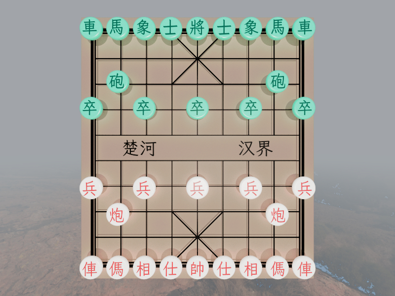

# Chinese Chess · 中国象棋

<div align="center">

**基于 C++23 与 Vulkan 1.4 的实时 3D 中国象棋（Xiangqi）渲染引擎**

光栅化 / RT Pipeline / Ray Query 三种渲染模式 | 无偏蒙特卡洛路径追踪 | ACES 2.0 色彩管理



</div>

---

## 项目简介

实时 3D 中国象棋可视化引擎：GLB 棋盘/棋子 + FreeType 运行时文字图集，32 枚棋子（16 红 + 16 黑）按中文棋谱逐步回放，相机、灯光、材质与模型可在 ImGui 面板中编辑。渲染侧提供**前向光栅化（MSAA）**、**RT Pipeline 路径追踪**、**compute + Ray Query 路径追踪**三种互切模式，共用同一份场景数据（设备地址直取，切换零重传），**启动默认 RT Pipeline**。

引擎层为自研 **Vulkan 1.4 RAII 封装**（`vulkan.hpp` + VMA），仅用动态渲染（无 render pass 对象）；着色器用 **Slang** 运行时编译为 SPIR-V 1.6 并做依赖感知磁盘缓存；同步模型为**时间线信号量 + 回收站**的无栅栏帧循环。

> **编写说明**：引擎层（`vulkan_core`、`scene` / `ui` / `window` / `tools`、CMake）由作者手写；`shaders/` 下的 Slang 着色器由 AI 生成，作者负责结构设计、C++ 侧整合联调与画质调优。GPU 结构布局与同步语义以 C++ 侧为准，两端需共同维护。

---

## 功能特性

### 🎮 核心功能

| 功能 | 说明 |
|------|------|
| **3D 棋盘与棋子** | GLB 模型；「楚河汉界」与棋子文字由 FreeType 运行时栅格化（霞鹜文楷 GB Medium） |
| **棋谱回放** | ICU4C 检测 GB2312/UTF-8，正则解析中文记谱法，逐步播放（W/A 上一步，S/D 下一步） |
| **ImGui 控制面板** | 渲染模式下拉 + 相机 / 灯光 / 材质·物体 / 棋谱 4 个面板（docking + 多视口） |
| **截图保存** | **C** 键保存当前帧（仅场景、不含 UI），编码写盘在后台线程 |
| **热重载** | **F5** 重编译当前渲染器的着色器与 pipeline（失败保留旧管线）；**F6** 重热重载磁盘纹理 |
| **字体渲染** | FreeType 字形图集（单字 + 棋盘多字），4 对齐居中、`padding=2` 防渗墨，UASTC 压缩 |
| **RenderDoc 帧捕获** | Debug：UI 操作使场景变脏后本帧自动捕获（跳过首帧） |

### 🎨 渲染特性

| 功能 | 说明 |
|------|------|
| **三种渲染模式** | 前向光栅化（MSAA + resolve）/ RT Pipeline / compute + Ray Query（与 RT 逐像素同分布）；UI 一键切换，默认 RT |
| **路径追踪器** | 子像素抖动 + 严格样本均值累积；材质解析 + 介质衰减 + 自发光 + 光源/环境 NEE + 轮盘赌 + BSDF 弹射，最大 8 次弹射 |
| **俄罗斯轮盘赌** | 按路径吞吐量自适应终止，存活概率下限 0.05 且**始终按真实概率归一**（不做截断，保持无偏） |
| **时域累积** | 渐进式，严格样本均值，`MAX_SAMPLES` 后冻结；Wang Hash + 帧号种子 + 子像素抖动 |
| **三种光源类型** | （仅光线追踪）方向光、点光源（平方衰减 + Range 裁剪）、聚光灯（内外锥角平滑过渡） |
| **阴影光线** | Any-Hit + `ACCEPT_FIRST_HIT_AND_END_SEARCH` + `SKIP_CLOSEST_HIT` + 图元剔除；半透明表面按 `opacity` 概率穿透 |
| **天空盒** | 全屏三角形直接采样 equirect 2D HDR（`cracked ground.hdr`，不生成 CubeMap），过暗回退程序化渐变天空 |
| **ACES 2.0 色彩管理** | OpenColorIO：CPU 截图变换 + GPU 合成 Pass 编译期注入（`all-views studio` config） |

### ⚙️ 工程特性

| 功能 | 说明 |
|------|------|
| **现代 C++23** | `std::ranges` / `views`、Concepts、`std::expected`（可恢复的 data/IO/parse）与 `optional`（未找到）、`std::format` / `println`、`/W4 /WX` |
| **Vulkan RAII 封装** | `vulkan_core/` 16 组：application、device、physical_device、swapchain、buffer、image、commandbuffer、queue、semaphore、recycle_bin、pipeline(+cache)、descriptor、sampler、acceleration_structure、shader_binding_table |
| **时间线信号量 + 回收站** | 资源与 signal 值配对，GPU 越过即销毁；一次性 CB 立即提交，`begin_record` 不做 CPU 等待，帧槽 pacing 由循环顶部 `wait_frame()` 承担；帧循环无 Fence / 无 `vkDeviceWaitIdle` |
| **智能队列选择** | `cartesian_product` 穷举队列族组合（专用传输队列 10× 加分）；BLAS/TLAS 构建与全部帧提交都在 graphics 队列 |
| **显式同步与上传** | 消费者 stage/access 由调用点传入（几何含 AS 构建读、间接参数 `eDrawIndirect`、纹理 `eShaderSampledRead`），barrier 一律由 `transition_state()` 依追踪状态生成；≤ 64 KiB 且 4 字节对齐的上传走 `vkCmdUpdateBuffer` 内联，超限才走两段式 QFOT |
| **管理器架构** | model（顶点/索引、BLAS/TLAS、间接绘制）/ material（材质、bindless 纹理、KTX2）/ light 三个 manager 各自自查 `is_dirty`，`scene_manager` 折叠四个 `update()` 的返回值 + `need_descriptor_update` 决定重建描述符或仅重置累积；`meshes_dirty` 区分几何与实例更新 |
| **异步截图** | 三段式 QFOT 回读后把 wait 值 + staging buffer 交给 `std::jthread`：等 GPU 信号 → `invalidate()` → CPU OCIO → OIIO 写 EXR/PNG |
| **KTX2 纹理管线** | 纹理与字体图集统一 **UASTC 中间格式**（内存压缩 → 同步写 sidecar → 加载时按设备转码），F6 同槽位换图，旧 imageview 走回收站 |
| **Pipeline / 着色器缓存** | pipeline cache 单实例 RAII（启动读盘、退出写盘、F5 不写盘，校验 vendor/device/UUID）；着色器缓存为依赖感知的单一序列化文件 `resources/cache/shader_cache.cache`（Debug 版 `shader_cache_debug.cache`），键 = 路径 + 入口集合 |
| **析构顺序加固** | 默认析构为成员声明逆序（app 在 scene/ui 之后、GLFW window 在 ui 之后、AS backing buffer 在 AS 之前）；`~vulkan_application` / `~scene_manager` / `~ui_manager` 开头自行 `wait_idle()` |

---

## 系统要求

| 组件 | 最低要求 |
|------|----------|
| **操作系统** | Windows 10/11 x64 |
| **GPU** | 支持 Vulkan 1.4、硬件光线追踪（`VK_KHR_ray_tracing_pipeline`）与光线查询（`VK_KHR_ray_query`） |
| **显存 / 内存** | 4 GB+ / 8 GB+（建议） |
| **编译器** | Visual Studio 2026（MSVC 14.51 / 平台工具集 v180） |
| **构建工具** | CMake（≥ 4.0）+ Ninja + vcpkg（manifest 模式） |

**设备扩展**（谓词/查询链与启用链 1:1）：

```
VK_KHR_swapchain, VK_KHR_acceleration_structure
VK_KHR_ray_tracing_pipeline, VK_KHR_ray_query
VK_KHR_deferred_host_operations
```

> `VK_KHR_synchronization2` / `VK_KHR_buffer_device_address` 已是 1.3 / 1.2 核心，改由同名 feature 结构启用。

**Features2 链特性**：`samplerAnisotropy`、`multiDrawIndirect`、`shaderInt64`、`dynamicRendering` / `synchronization2` / `shaderIntegerDotProduct`（1.3，用于 RNG 种子的整数点积）、`bufferDeviceAddress` / `runtimeDescriptorArray` / `scalarBlockLayout` / `timelineSemaphore`（1.2）、`shaderDrawParameters`（1.1）、`accelerationStructure`、`rayTracingPipeline` + `rayTraversalPrimitiveCulling`、`rayQuery`。2026-09 审计另移除了一批「请求并启用但无使用点」项（push descriptor、`fillModeNonSolid`、`extendedDynamicState` 等）以收窄设备选择。

---

## 构建

### 1. 初始化依赖

```bash
git submodule update --init --recursive
.\vcpkg\bootstrap-vcpkg.bat   # 首次使用 vcpkg 时引导
```

vcpkg 使用 manifest 模式（`vcpkg.json`），工具链由 `CMakeLists.txt` 指向本地 `vcpkg/scripts/buildsystems/vcpkg.cmake`；`vcpkg-configuration.json` 经 `overlay-ports`（`vcpkg-overlays/ktx`）提供自定义 ktx 端口（KTX-Software 5.0.0-rc1 + UASTC HDR）。默认注册表为 GitHub `microsoft/vcpkg`（国内可换镜像），VMA/VMA-HPP 随 baseline 解析（当前 3.4.0）。

### 2. 配置、构建与运行

```bash
cmake --preset x64-release     # 或 x64-debug
cmake --build out/build/x64-release
.\out\build\x64-release\chinese-chess.exe   # 资源路径全部相对，工作目录必须为 chinese-chess/
```

Visual Studio 2026：打开项目文件夹后在 CMakePresets 中选择 **x64-debug** / **x64-release**。`CMakePresets.json` 只定义 configurePresets，附带的 x86 与 Linux/macOS 预设未维护，仅 **Windows x64** 经过测试；CMake 已把调试工作目录设为 `chinese-chess/`。

> **源文件由 `GLOB_RECURSE` 收集**（`chinese-chess/**/*.{cpp,h,slang}`）⇒ 新增 / 删除 / 改名文件后必须重新 configure（改一下 `CMakeLists.txt` 即可触发），否则新文件不进工程。

**离线 / configure 失败时**：vcpkg 在 configure 阶段需联网；离线可直接用既有的 `out\chinese-chess.vcxproj` 走 MSBuild 做全量真实编译（Release / Debug 均可），**必须加 `/p:TrackFileAccess=false`**（沙箱禁止命名管道会让 CL 文件跟踪器报 `TRK0002`）。

### 编译选项

```
C++23（MSVC：/std:c++23preview）    /utf-8（源文件无 BOM UTF-8）    /W4 /WX（警告即错误）
NOMINMAX / UNICODE / _UNICODE       VK_USE_PLATFORM_WIN32_KHR / GLFW_INCLUDE_VULKAN
GLM_FORCE_RADIANS / GLM_ENABLE_EXPERIMENTAL / GLM_FORCE_DEPTH_ZERO_TO_ONE
```

include 路径 = `chinese-chess/`（项目根，所有 include 相对它）；`.gitattributes` 规定 `*.h` / `*.cpp` / `*.slang` 一律 LF。着色器缓存不感知编译器选项，改动 profile / 能力 / `ForceCLayout` 后须手动删除 `resources/cache/shader_cache.cache`。

---

## 使用说明

### 基本操作

| 按键 | 功能 |
|------|------|
| **W/A** | 棋谱上一步 |
| **S/D** | 棋谱下一步 |
| **C** | 保存当前帧截图到 `resources/captures/`（浮点格式 → `.exr`，8 位 → `.png`，含 CPU OCIO 变换；写盘在后台线程，连续按键会先 join 上一次写盘） |
| **F5** | 热重载：重编译当前激活渲染器的着色器与 pipeline（失败保留旧管线） |
| **F6** | 热重载：磁盘纹理变更检测 → 重压缩 KTX2 sidecar → 同槽位重上传 |
| **ImGui** | 控制渲染模式、相机、灯光、材质/物体与棋谱；相机无鼠标轨道控制，用面板数值调整 |

### 渲染模式切换

UI「渲染模式」下拉框（`光栅化` / `光线追踪 (RT Pipeline)` / `光线追踪 (Ray Query)`），**启动默认 RT Pipeline**。切换即重绑活动渲染器并置脏（场景数据零重传，仅重建描述符并重置时域累积）：光栅化是前向 PBR + MSAA 的实时路径，另外两条是路径追踪的渐进式收敛路径。截图时 `capture_frame` 用三条一次性命令缓冲做三段式 QFOT 回读，并把末条 CB 的 submit info 作为 `render()` 的返回值交给 `app->render()`，使该帧合成的等待链包含整条回读。

### 棋谱回放

将棋谱文件（`.txt`，中文记谱法）放入 `resources/records/`，再用 UI「棋局管理」→「加载棋谱」载入（支持 GB2312/UTF-8，ICU 自动检测编码），然后逐步查看对局（W/A 上一步，S/D 下一步，面板上也有「上一步」/「下一步」按钮）。记谱格式示例（每回合红黑交替）：

```
炮二平五，马8进7
马二进三，车9平8
...
```

### RenderDoc 帧捕获（Debug 构建）

安装 RenderDoc（`renderdoc.dll` 需在进程 DLL 搜索路径中）后，在 UI 中做任意操作（改材质、移光源等）使场景变脏，本帧即自动开始/结束捕获（跳过首帧；期间的 upload / TLAS 构建也在捕获内），结果存于 `resources/captures/`。

---

## 项目架构

| 目录 | 内容（共 45 个 .cpp TU） |
|------|------|
| `window/` (2 cpp + 1 h) | `glfw_window`：GLFW RAII / 帧循环 / 输入分发 / 截图 / RenderDoc；`main.cpp` 为入口 |
| `shared/` (3 对) | `gpu_shared_types`（C++ 与 Slang 共用的 GPU 布局结构 + 自检）、`cpu_shared_types`（`cpu_*` 场景数据：light / material / model_info / model_data / image）、`vulkan_shared_utils`（运行期全局 + 格式选择 / `align_up` / 矩阵转换 / upload·download QFOT） |
| `vulkan_core/` (16 对) | Vulkan RAII 封装层：编排器 application（合成 / pipeline cache / 格式选择）、物理设备与队列选择、交换链、管线与描述符、资源与同步原语（类清单见「工程特性」） |
| `scene/` (9 对) | `scene_manager`（3 渲染器 map、F5/F6、`render` / `capture_frame`）、`scene_base`（proxy facade）、`scene_camera`、model / material / light 三个 manager、三个渲染器 |
| `ui/` (6 对) | `ui_manager`（ImGui 初始化 / 合成 / 渲染模式下拉）、`ui_base`（proxy facade）、`ui_camera` / `ui_light` / `ui_node`（材质·物体）/ `ui_record`（棋谱回放） |
| `tools/` (9 cpp + 10 h) | `shader_compiler`（Slang→SPIR-V + 缓存）、`model_loader`（fastgltf）、`image_helper`（OIIO + KTX2）、`ocio_helper`、`font_loader`、`record_loader`、`file_watcher`、`string_helper`、`renderdoc_capture`（+ vendored 头） |
| `shaders/` (9 个 .slang) | 5 个模块 + 4 个入口文件，见「着色器」 |
| `resources/` | `models/` 3 个 tracked `.glb`（chess_board / chess_board_line / chess_piece）；`fonts/` 只跟踪 LXGWWenKaiGB-Medium.ttf + OFL.txt；`textures/` cracked ground.hdr（约 90 MB）；`ocios/` 5 个 ACES 2.0 config；`records/` 棋谱1.txt（GB2312）；`captures/`；`cache/` pipeline·shader·hash（ignore，运行时 `.ktx2` sidecar 亦 ignore） |

**分层与命名**：`window/` 只碰窗口与帧循环，`ui/` 经 `scene_manager&` 操作场景，`scene/` 直接持有三个 manager 的具体类型；UI 面板与渲染器都做 `pro::proxy` 类型擦除。命名：`gpu_*` = 与 Slang 共用声明的 GPU 结构、`cpu_*` = CPU 侧场景数据（都在 `shared/`）、`scene_*` = 场景层管理器 / 渲染器与 `scene_camera`、`vulkan_*` = Vulkan RAII 包装（命名空间 `vulkan_shared_utils` 是唯一例外）。数据路径：`model_loader` → `cpu_model_info`（顶点/索引 + BLAS）→ `scene_model_manager` 上传缓冲并构建 TLAS，材质与灯光数组经各自 manager 上传，纹理走 bindless 槽。

**每帧数据流**：`wait_frame()`（等本帧槽上次 signal）→ `glfwPollEvents()` → `ui->update()` → `scene->update()`（脏检查：重传数组、重建 BLAS/TLAS 与间接绘制命令，`meshes_dirty` 才重传顶点索引；四个 `update()` 任一报告变化或 `need_descriptor_update` 时重建描述符，只有相机动时仅重置累积）→ `ui->render()` 与 `scene->render(need_capture)`（各自写场景 UBO、提交并 signal timeline）→ `app->render({ui_wait, scene_wait})`（回收站 release → acquire swapchain → barrier → blend 全屏三角形合成 scene+UI → present）。`vulkan_application` 为两步初始化：先 `init` 建 Instance，再 `create` 建设备/交换链/管线，其间创建 Window Surface。

---

## 渲染技术

### 估计量（两条光追路径共用 `pbr` / `lighting` / `path_tracing` 的全部数学；RT Pipeline 为参考实现，Ray Query 逐像素同分布，只换求交 API）

- **BSDF**：`(1-transmission)·[Lambert(diffuse_albedo) + GGX(f0)] + transmission·[介质界面 F·δ_reflect + (1-F)·δ_refract]`；`f0 = lerp(0.08·reflectance, albedo, metallic)`、`diffuse_albedo = (1-metallic)·albedo`、`alpha = roughness²`。
- **无偏落点**：`shading_context` 的 eval / pdf / sample 严格一致，波瓣权重统一取 `eval·cosθ/pdf`（混合 pdf 有余弦项托底 ⇒ 权重有界，**不需要 firefly 钳制**）；delta 光源的 NEE 权重恒 1，环境光 NEE 与 BSDF 采样做 `power_heuristic` MIS；介质按段解析结算 Beer-Lambert `exp(-σ_a·d)`，不做背面剔除。材质语义：反照率 = `lerp(background_color, foreground_color, alpha_map.r)`，`reflectance` → 电介质 F0 = 0.08·reflectance，`absorption` = 介质 σ_a，`opacity` = 阴影透射率，`transmission` = 平滑介质界面分支概率。

### 光栅化管线（`scene_rasterization_render.slang`）

- 前向 PBR + MSAA/resolve（自动取设备最高采样数），单次 `drawIndexedIndirect`（`is_show` → instanceCount 0/1），顶点输入 `{position, normal, uv}` + 深度测试 + 背面剔除；与光追共用 BRDF 与光源采样，环境光为解析式廉价 IBL。**没有可见性项 ⇒ 无阴影 / 无 AO**。
- **天空盒**：`environmentVertMain` / `environmentFragMain` 全屏三角形（无顶点输入、深度测试/写入全关），方向由 `proj_inv` / `view_inv` 反投影近远平面之差得到（与 `rayGenMain` 同一套），直接采样 equirect 2D HDR、**不生成 CubeMap**；与几何管线共用同一批 descriptor set（`b0` UBO、`b1` bindless 纹理）。

### 色彩管理与纹理

- **色彩管理**：HDR 场景图 `R16G16B16A16_SFLOAT`；截图在 CPU 侧做 OCIO 变换，GPU 合成 Pass 用 `generate_shader_info` + `replace_and_compile` 注入 OCIO 代码并上传 LUT 纹理与 UBO。交换链在 `USE_OCIO = true` 时取 `B8G8R8A8_UNORM`（由 OCIO 变换），否则取 `B8G8R8A8_SRGB` 交给 Vulkan；present 优先 Mailbox、回退 FIFO。
- **KTX2**：sidecar 存在且源未变 → 直接 `read_ktx2`（UASTC 无条件转码 BC6H/BC7），否则内存压缩 → 转码前同步写 sidecar → `upload_ktx2`；字体图集走单通道 BC4（移动端 EAC_R11），失败回退 R8。

---

## 着色器

`shaders/` 共 **9 个 .slang**：5 个模块（`shader_utils` / `gpu_shared_types` / `pbr` / `lighting` / `path_tracing`）+ 4 个入口文件。

| 着色器 | 管线 | 入口点 | 作用 |
|--------|------|--------|------|
| `scene_raytracing_render.slang` | RT | `rayGenMain` / `rayClosestHitMain` / `rayMissMain` / `rayShadowMissMain` / `rayShadowAnyHitMain` | 参考实现：无偏 MC 路径追踪 |
| `scene_rayquery_render.slang` | Compute | `rayQueryComputeMain`（`[numthreads(8,8,1)]`） | 与 RT 逐像素同分布，只换求交 API |
| `scene_rasterization_render.slang` | Graphics | `vertMain` / `fragMain`（几何）、`environmentVertMain` / `environmentFragMain`（天空盒） | 前向 PBR + MSAA + 全屏三角形天空盒 |
| `vulkan_blend_image.slang` | Graphics | `vertMain` / `fragMain` | scene + UI alpha 合成；`ocio_conversion()` 桩须保持单行（按整行替换注入 OCIO） |
| `path_tracing.slang` | 模块 | — | 两条光追路径共享的上下文（命中几何、材质解析、插值、RR 权重、环境 miss 贡献、累积写入） |
| `pbr.slang` | 模块 | — | `microfacet`（GGX + Smith + VNDF 采样/eval/pdf）、`pbr_material`、`bsdf_sample`、`shading_context` |
| `lighting.slang` | 模块 | — | delta 光源采样、equirect 环境 + 程序化回退、NEE / MIS 权重 |
| `shader_utils.slang` | 模块 | — | 常量（`MAX_BOUNCES=8`、`RR_START_DEPTH=2`、`RR_MIN_PROBABILITY=0.05`、`MAX_SAMPLES=2048`）、RNG（SplitMix64 播种 + PCG32 流,64 位种子）、采样、`power_heuristic`、累积 |
| `gpu_shared_types.slang` | 模块 | — | 只有一行：`#include "../shared/gpu_shared_types.h"` |

依赖关系：`pbr ← lighting ← path_tracing ← { scene_raytracing_render.slang, scene_rayquery_render.slang }`；`scene_rasterization_render.slang` 只 import `shader_utils` / `gpu_shared_types` / `pbr` / `lighting`；`vulkan_blend_image.slang` 自足。

- **Slang 风格**：有状态 / 内聚概念写成 `struct` + 成员函数，改自身状态的标 `[mutating]`；枚举量用限定名（`light_type::directional`）；模块是独立编译单元，多处引入同一份声明会报 `ambiguous reference`（Slang 侧只能有一个 include 点）。
- **编译**：profile = `spirv_1_6`，选项含 `EmitSpirvDirectly`、`VulkanUseEntryPointName`、`MatrixLayoutColumn`、`Capability(spvRayQueryKHR)`、`ForceCLayout`（优化级别按 Debug/Release 切换）；Slang 分析依赖文件并逐个计算 SHA-256 作为指纹写入磁盘缓存。

---

## 依赖项

依赖与用途（由 `vcpkg.json` 声明）：

- **glfw3** 窗口与输入；**glm** 数学；**vulkan-headers** + **vulkan-utility-libraries** Vulkan API 与工具头
- **vulkan-memory-allocator-hpp** GPU 内存分配（VMA C++ RAII，当前 3.4.0）
- **imgui** 1.92.8（docking-experimental + glfw/vulkan binding）docking 与多视口 UI
- **fastgltf** glTF/GLB 加载；**freetype**（error-strings）字形栅格化
- **opencolorio** + **yaml-cpp** ACES 2.0 色彩管理（CPU 变换 + GPU shader/LUT）；yaml-cpp 为其依赖，显式 `find_package`
- **openimageio** PNG/EXR/HDR 读写；**openssl** SHA-256；**proxy**（msft_proxy4）类型擦除 facade
- **shader-slang** Slang→SPIR-V；**icu** 字符集检测 / 编码转换 / 正则
- **ktx**（overlay port，KTX-Software 5.0.0-rc1 + UASTC HDR）纹理压缩与加载

---

## 已知限制与取舍

**渲染建模近似**（不是估计量偏差，而是 BRDF / 模型定义）：

- **光栅化无阴影 / 无 AO**：前向 PBR 没有可见性项，要阴影需另加 shadow map pass。
- **GGX 单次散射**：无多重散射能量补偿（Disney / glTF 的标准选择）。
- **法线变换**：只做模型矩阵变换而非逆转置，非等比缩放下不精确。
- **嵌套透射介质**：不追踪各层各自的 σ_a。
- **透射界面 NEE 贡献为 0**：焦散只能靠 BSDF 采样，噪声高。
- **MSAA 采样数**（设计选择）：取设备支持的最高采样数（开发机 8×）；深度格式按 `D32_SFLOAT` → `D32_SFLOAT_S8_UINT` → `D24_UNORM_S8_UINT` 取首个支持项。

**资源与画质取舍**：

- **字体图集单层 mip**（设计选择）：`mipLevels=1` + `maxLod=0`，缩小时欠采样闪烁；要平滑需补 mip 链（`upload_image` 目前没有 `eTransferSrc`）。
- **bindless 1024 槽**：未启用 `ePartiallyBound`、未查询设备上限（部分移动/集成设备可能创建失败）；未写满的尾部槽位靠 shader 双守卫规避，技术上未定义。
- **棋谱恢复整体置脏**（效率取舍）：回放「恢复局面」用整体 `need_update()`，每步棋 / 选择 / 加载都置脏三个 manager，实际只有模型的 `is_show` 与矩阵变化。
- **连续截图会短暂阻塞主线程**：单个 `std::jthread` 的移动赋值先 join 上一次写盘；要真正无阻塞需作业队列 + staging buffer 排队。
- **OCIO GPU 合成**：blend 描述符由 `create_pipeline` 顺序 `add_binding` 声明（layout 与池容量同出于这份累加声明），OCIO 纹理按索引顺序追加，binding 须自 0 起连续。
- **ImGui 多视口验证层误报**：imgui 1.92.8 的已知问题，窗口拖到主视口外时触发 `UNASSIGNED-non-acquired-swapchain-image-used`。
- **RenderDoc 不捕获第一帧**：捕获第一帧会导致无法启动，故跳过首帧；且捕获不含 UI 侧上传（`ui->update()` 在 `begin_capture` 之前）。
- **每帧一次 CPU 等待**：`begin_record` 不再各自等待，改为循环顶部统一 `wait_frame()`。
- **离线环境 configure 需联网**：vcpkg 在 configure 阶段解析依赖，离线只能走既有 `.vcxproj` + MSBuild（记得 `/p:TrackFileAccess=false`）；x86 / Linux / macOS 预设未维护。
- **VMA-HPP 头路径**：vcpkg 安装的 VMA-HPP 找不到 VMA 头，需手动把 `vk_mem_alloc.hpp` 中的 `vk_mem_alloc.h` 改为 `vma/vk_mem_alloc.h`（缺头会报 C1083）；重装 vcpkg 依赖后需复核该修改。
- **着色器缓存不感知编译器选项**：改动 profile / `ForceCLayout` 等后必须手动删除 `resources/cache/shader_cache.cache`。

---

## 许可证

本项目基于 **MIT License** 开源。详见 [LICENSE.txt](LICENSE.txt)。

使用的第三方资源：

- 字体：**LXGW WenKai GB / 霞鹜文楷 GB**（SIL Open Font License）
- 字体：**Source Han Sans SC / 思源黑体**（SIL Open Font License）
- RenderDoc API 头文件：**RenderDoc**（MIT License, Copyright Baldur Karlsson）
