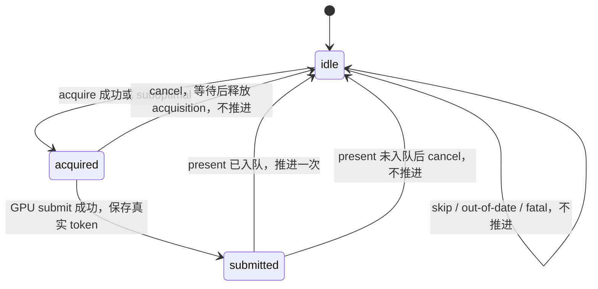

# T02 实施与跨会话交接

日期：2026-10-18。任务来源：`PROJECT_ADJUSTMENT_PLAN.md` 的 T02。用户明确要求 **T00 最后做，当前先做 T02**；该顺序优先于旧依赖表。本任务不实施 T00，不提交或推送，不覆盖进入时的用户修改。

状态：**DONE（功能修复保留）**。2026-10-18 随后按用户指令移除全部项目测试、测试钩子/选项、错误注入和测试产物。T00 和后续任务的测试框架工作暂缓，待项目进一步完善且用户明确要求后再恢复。历史验证结果不代表当前仍有相应测试入口。

## 1. 接手入口

先读本文件、实施方案的最新用户指令、`CLAUDE.md` 和根 `CMakeLists.txt`，再执行 `git status --short`。工作区含之前 T01 和用户已有修改，包括资源删除，不能 reset/checkout 覆盖。本文用符号定位；当前不建立或运行自动化测试，只检查普通产品构建。

核心文件及职责：

| 入口 | 当前契约 |
|---|---|
| `vulkan_frame_scheduler.{h,cpp}` | 每个 swapchain 唯一的 frame-slot 游标；维护 acquire fence/semaphore 与真实成功提交 token |
| `vulkan_swapchain.{h,cpp}` | surface/swapchain、image-indexed present semaphore/fence、显式 acquire/present 结果、取消与重建 |
| `vulkan_application::{begin_frame,render,cancel_frame,resize}` | 主帧 acquire、合成、提交、呈现；校验 slot/image/generation |
| `window::{render,resize_callback}` | 合并 resize 请求，跳过最小化/零尺寸，处理 ready/skip/recreate/fatal 与异常取消 |
| `scene_manager::render`、三个 `scene_*_render::render`、`ui_manager::render` | 接收 scheduler 的 slot；不再各自推进 frame 计数 |
| `ui_viewport_renderer`、`imgui_viewport_bridge.h` | 副窗口使用相同 WSI 调度实现，保留 ImGui 绘制与私有 VBO/IBO 管理 |
| `third_party/imgui/` | 固定 1.92.9b Vulkan backend，加一个私有 buffer-owner 初始化桥；保留 MIT 许可与升级说明 |

## 2. 帧与完成凭据

主循环先 poll、处理关闭/最小化、合并重建，再 acquire。只有 acquire ready 后才生成该帧 UI、scene 和 final composition。frame context 包含 `slot/image/generation`；UI、scene、三个渲染器的 UBO/descriptor/command buffer 均使用传入 slot。RT/RQ 采样累计计数仍独立，不能误删。

每个 slot 在复用前等待上次最终提交 token 和 acquire fence。成功提交才保存 token，失败不伪造完成值。acquire semaphore 随 slot；render-finished semaphore 和 present fence 随实际 image index。请求至少 `MAX_FRAMES_IN_FLIGHT + 1` 张 image，并服从 surface 最大/最小数量限制；不能假定驱动返回数量等于请求数量。

合成的 acquire wait 与首次 image layout barrier 均使用 COLOR_ATTACHMENT_OUTPUT，确保 barrier 位于 semaphore 等待之后。present semaphore 用 ALL_COMMANDS 信号，包含最终 PRESENT_SRC 布局转换。不同 graphics/present family 使用 concurrent sharing；对应实际 VkQueue 的包装共享 mutex 与 timeline 状态。`vulkan_queue::present` 使用同一 mutex，返回原始结果供状态机分类。

## 3. 呈现生命周期与异常

实例要求 KHR get_surface_capabilities2 / surface_maintenance1；设备筛选同时要求 KHR swapchain_maintenance1 extension 和 feature，创建逻辑设备时显式启用。缺少时给出启动错误，不引入旧驱动兼容分支。`vulkan_application::create` 先用 RAII 接住 surface，设备选择失败也会释放。

每次 present 链接 `VkSwapchainPresentFenceInfoKHR`。成功、SUBOPTIMAL、OUT_OF_DATE、SURFACE_LOST 都按规范处理已经入队的 semaphore 等待与 acquisition 释放；OOM 没入队，保留 acquired 状态以供取消。surface lost/device lost 为 fatal，正常程序停止；测试中的后续恢复只适用于未真实破坏 surface/device 的模拟结果。

SUBOPTIMAL acquire 仍有有效 image 和已发出的 acquire 信号，必须完成本帧或取消后才能重建。acquire OUT_OF_DATE 请求重建，TIMEOUT/NOT_READY 跳过。等待旧 image 的 present fence、所有 slot token 和 acquire fence 后才能释放其 view/semaphore/swapchain。present fence 证明资源可安全回收，不证明像素已经显示在屏幕上。不能以 graphics timeline 或 device/queue idle 替代此证明。

取消 acquired 帧先等待 slot token、acquire fence、最新 graphics token（覆盖部分 UI/scene 提交），再调用 `releaseSwapchainImagesKHR`，并替换已经 signaled 但没有 wait 的二进制 semaphore，保留当前 slot。最终提交成功但 present OOM 同样走该路径。析构取消使用不重新分配 semaphore 的路径，避免内存压力下的清理再分配；device lost 清理保留明确诊断，其他不能证明安全的清理失败不静默销毁。

resize 回调只设置请求标记；主循环读取最新实际 framebuffer extent，合并多次事件，等待相关工作/呈现完成后重建。旧 view/semaphore 先销毁再替换旧 swapchain。创建交换链因尺寸竞争返回 OUT_OF_DATE 时，清理可能已 retired 的旧链并保留重建请求；无有效链时 acquire 返回 recreate。最小化/零尺寸不进入 acquire，并持续处理关闭事件。

截图 readback 持有自己的 staging buffer、真实 token 和旧 width/height 元数据。重建等待旧 GPU 使用完成，CPU 保存线程可继续。历史上已验证旧尺寸保存任务跨越真实 resize 后可完整解码；专用 latch 和测试路径现已移除，正常截图保存逻辑保留。

## 4. ImGui 多窗口

上游 1.92.9b helper 在创建 secondary swapchain 时会把所有 image 转为 PRESENT_SRC，包含尚未 acquire 的 image；上游呈现回收也没有 maintenance1 fence。因此仅替换 render/present 回调仍不足以合格。

仓库保存同版本 `imgui_impl_vulkan.{cpp,h}` 和许可，直接编入应用，静态 vcpkg 库的 Vulkan backend 对象不会被选入。桥函数只初始化上游私有 VBO/IBO owner（`WindowOwned=false`）并创建正常的 single-sample viewport pipeline；surface、swapchain、command buffer、acquire/present/fence 全由应用拥有。主 UI 的 MSAA 保留。副窗口要求与主 UI 相同 color format；不支持时明确报错。

副窗口每个 swapchain 有自己的 scheduler；自己的 CB 和 ImGui buffer ring 数量均为 MAX_FRAMES_IN_FLIGHT。关闭先 drain GPU 与 presentation，再删除上游 buffers，最后由 GLFW 删除 native window。resize 回调只置标记。主/副窗口的 ImGui DrawData 调用都持有 graphics 队列 mutex，因为上游字体/纹理上传可能直接 submit/waitIdle；其已有上传等待未新增到每帧/resize 路径。

所有 C 回调捕获异常并保存 exception_ptr，回到 `ui_manager::render` 后重抛，进入主帧取消与正常退出。析构先 DestroyPlatformWindows，再恢复原 callbacks、Shutdown Vulkan/GLFW backend、销毁 context。升级 ImGui 必须同步更新固定源码、头、版本断言并重新验收；具体见 `third_party/imgui/README.md`。

## 5. 历史验证与当前清理

移除测试前，普通产品 Debug/Release 构建、两配置各 200 次窗口循环与 201 对副窗口创建/关闭、错误分支注入、最小化关闭、各 3 次截图跨尺寸解码、T01 独立回归和 T02 ASan 曾通过。本机为 Windows x64、RTX 4060 Ti，主应用 graphics/transfer/present family 为 0/1/2，3 frame slots / 4 images。这些是历史执行记录，当前不提供自动化复测入口，也不声称已覆盖真实设备丢失或驱动 OOM。

清理前暴露并修复过三个问题，保留事实供维护者理解：

1. Vulkan-Hpp release 参数重载选错，image index 被当作 count；现明确传 count=1 和 index 指针。
2. 上游副窗口 helper 初始化未 acquire 的 image；现通过桥接完全绕开该 WSI 路径。旧检查器曾漏掉 UNASSIGNED，一次 PASS 因此作废，修正后重新验证。
3. 扩展校验只枚举全局扩展，漏掉 layer 提供的扩展；现同时枚举启用 layer 的扩展。测试专用 layer-settings 注入现已删除。

按最新用户指令已删除：项目 tests 目录、窗口测试源文件、测试 CLI/CMake 开关、截图线程 latch、专用测试 UI、acquire/present 注入、测试专用 GPU/生命周期输出、相关测试构建目录和已确认的测试截图。普通 Debug 验证层、实际截图、队列同步、呈现 fence 和副窗口功能保留。

当前只执行普通 Debug/Release 构建检查，不建立 CTest、测试框架或专用测试配置。删除测试不构成额外正确性证明。

## 6. 后续工作边界

继续完善项目实现；T03 缓存、T04 输入/法线、T07 GPU 场景拆分、T10 后台任务等仍按实施方案推进。T00 尚不到实施阶段，T05/T15 等任务中的测试框架与自动化工作同样暂缓，恢复须由用户另行明确要求。不要根据旧文档、旧验收矩阵或本次历史结果自动恢复测试。

T01/T02 的生产修复不回退，不把主帧 slot 改回多个私有游标。ImGui 后端定制仍是当前副窗口修复的一部分，与测试清理无关。

规范依据：[present semaphore 复用](https://docs.vulkan.org/guide/latest/swapchain_semaphore_reuse.html)、[swapchain maintenance1](https://docs.vulkan.org/refpages/latest/refpages/source/VK_KHR_swapchain_maintenance1.html)、[present fence](https://docs.vulkan.org/refpages/latest/refpages/source/VkSwapchainPresentFenceInfoKHR.html)、[vkQueuePresentKHR 错误语义](https://docs.vulkan.org/refpages/latest/refpages/source/vkQueuePresentKHR.html)。
